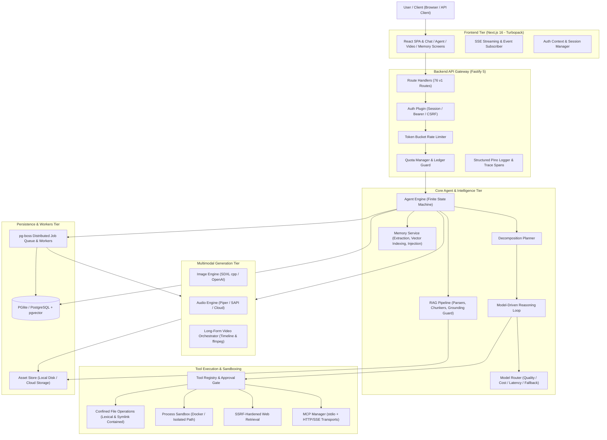
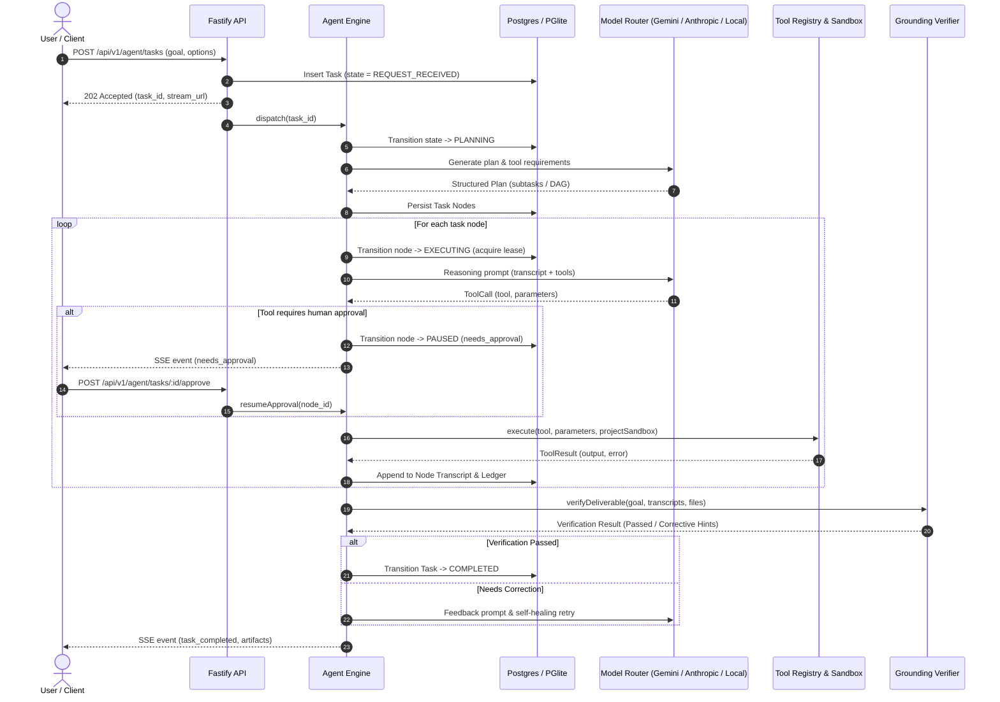
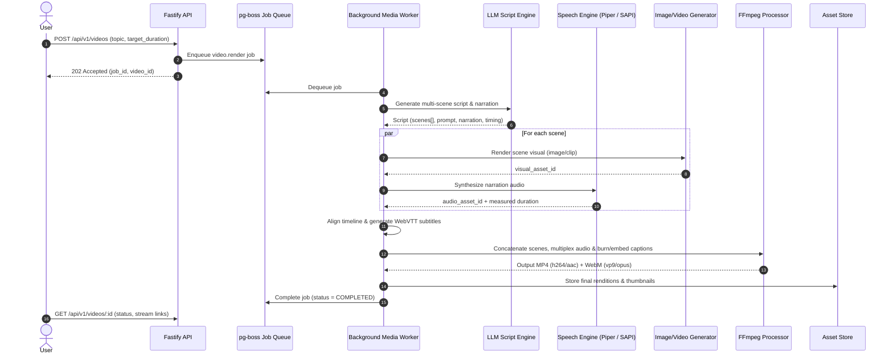

# Architecture and Data Flows: Universal AI Agent Platform

**Document Version:** 1.0.0  
**Scope:** Universal AI Agent & Smart AI Module System Architecture  
**Status:** SEMANTICALLY_VALIDATED & STRUCTURALLY_VALIDATED  

---

## 1. High-Level Architecture Overview

The platform is designed as a multi-tenant, modular, provider-independent autonomous AI orchestration platform.

---

## 2. Core Subsystems

### 2.1 Backend API & Authentication Gateway (`backend/`)
- **Framework:** Fastify 5 with strict schema validation (Zod + `@sinclair/typebox`).
- **Authentication Protocols:**
  - `httpOnly`, `SameSite` resolved session cookies.
  - Double-submit CSRF protection for mutating browser requests.
  - Project-scoped Bearer API keys (`pk_...`) for automated pipelines.
  - Mandatory project tenancy: all resource operations are scoped by `project_id` via PostgreSQL predicates.
- **Security Boundaries:**
  - Non-public routes deny by default unless explicitly decorated.
  - API keys are explicitly barred from modifying account-level ownership or session tokens (`ADR-147`).
  - IP resolution strictly honors configured reverse-proxy hops (`TRUST_PROXY_HOPS`).

### 2.2 Autonomous Agent Engine (`backend/packages/agent-core`)
- **State Machine Lifecycle:**
  `REQUEST_RECEIVED` → `UNDERSTANDING` → `PLANNING` → `EXECUTING` → `VERIFYING` → `COMPLETED` / `FAILED` / `PAUSED` / `CANCELLED`.
- **Node-Level Execution & Leases:**
  - Distributed node claiming via database leases (`claimed_until`, `claimed_by`).
  - Automatic stale lease recovery (`takeOverExpiredLeases`).
  - Bounded exponential backoff with jitter and `maxAttempts`.
- **Human-in-the-Loop & Approval Gating:**
  - Tool actions classified into risk tiers (`safe`, `sensitive`, `destructive`).
  - Destructive tools (terminal execution, code patching, project deletion) mandate human confirmation before execution.
  - Transient approval state stored with cryptographic call binding (preventing recycled call-ID spoofing, `ADR-108`).
- **Self-Healing & Grounding Guards:**
  - Independent post-execution verifier checks outputs against ground truth and invariants.
  - Grounding refusals reject model hallucinations before delivering final state to the user.

### 2.3 Provider-Independent Model Router (`backend/packages/model-router`)
- **Provider Abstraction Layer:** Common interface across OpenAI, Anthropic Claude, Google Gemini, and Local Ollama/vLLM.
- **Dynamic Routing Policies:**
  - Quality tier (coding/complex reasoning vs rapid summarization).
  - Provider health, rate limits (HTTP 429 backoff), and automated fallbacks.
  - Pre-flight quota estimation and post-flight actual token/credit ledger tracking.
- **Fail-Safe Operation:** Production rejects mock providers unless explicitly set for synthetic test suites.

### 2.4 Media & Multimodal Pipelines (`backend/packages/media`)
- **Image Generation:** Local diffusers (`stable-diffusion.cpp` GGUF models) or remote DALL-E adapters with resolution and seed reproducibility.
- **Audio Synthesizer:** Piper neural TTS / Windows SAPI with speech rate and voice pitch configuration.
- **Video Production Engine:**
  - Modular script generation with scene decomposition.
  - Per-scene storyboard rendering, narration synthesis, and subtitle timecoding (`WebVTT` / `mov_text`).
  - Audio/video multiplexing, scene transition concatenation, and WebM/MP4 dual-rendition encoding via `ffmpeg`.

### 2.5 Sandboxing & Tool Containment (`backend/packages/tools`)
- **Filesystem Containment:**
  - Path canonicalization resolves symlinks before containment evaluation (`ADR-088`).
  - Relative lexical escapes (`../`) and target symlinks outside project workspace are rejected.
- **Subprocess Isolation:** Commands run inside designated project sandbox directories with CPU/memory ceilings.
- **SSRF Hardening (`web.fetch`):**
  - Rejects private IPv4 (`10.0.0.0/8`, `172.16.0.0/12`, `192.168.0.0/16`), loopback (`127.0.0.1`, `::1`), link-local/cloud metadata (`169.254.169.254`), and IPv6 mapped ranges.
  - Socket IP address pinning prevents DNS rebinding attacks.

---

## 3. Data Flow Diagrams

### 3.1 Autonomous Agent Task Execution Loop

### 3.2 Long-Form Video Assembly Pipeline

