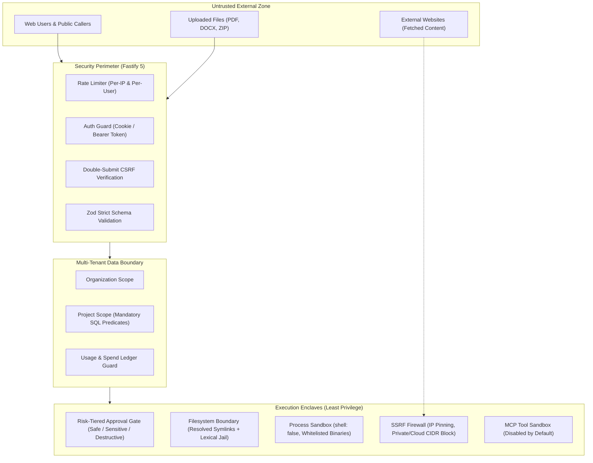

# Security and Reliability Forensic Audit

**Audit Date:** 2026-10-20  
**Target Systems:** Fastify API, Multi-Tenant Database, Tool Sandboxes, Web Fetch, MCP Integration  
**Classification:** FORENSICALLY_AUDITED & SEMANTICALLY_VALIDATED  

---

## 1. Trust Boundaries & Security Enclaves

---

## 2. Forensic Vulnerability Analysis & Validated Controls

### 2.1 Multi-Tenant Isolation
- **Mechanism:** Every database table containing tenant artifacts (`tasks`, `conversations`, `messages`, `documents`, `usage_records`, `api_keys`) includes `project_id` and `organization_id`.
- **Enforcement:** `requireProject` plugin verifies project membership in SQL before any handler runs. An unauthorized caller receives HTTP 404 (preventing project ID enumeration), while a token specifying a mismatched project receives HTTP 403.
- **Admin Isolation (`ADR-108`):** System administrators do not have implicit access to private tenant projects. Administrative rights are strictly partitioned to `/api/v1/admin/*`.

### 2.2 Shell Command & Path Traversal Injection Defenses
- **Argument Injection Defense (`ADR-032`):**
  - All process execution (`terminal.run_command`, probe utilities) uses `shell: false`. No raw user input is piped to shell parsers (`cmd.exe` / `bash`), completely mitigating command substitution (`$(...)`, `&&`, `|`) attacks.
- **Symlink & Lexical Jail (`ADR-088`):**
  - `resolveSandboxedPath` calls `realpath` / resolves symlinks on the physical filesystem before checking whether the canonical path resides inside `project_workspace`.
  - Attempts to escape via symbolic links or directory traversals (`../../`) throw a `SandboxError` and are recorded in the audit log.

### 2.3 SSRF Hardening (`web.fetch`)
- **Address Resolution & Pinning:**
  - Resolved IP addresses are verified before the HTTP request is dispatched.
  - Sockets are pinned directly to the validated IP to prevent DNS rebinding attacks.
- **Denied Ranges:**
  - IPv4 Private: `10.0.0.0/8`, `172.16.0.0/12`, `192.168.0.0/16`.
  - Loopback: `127.0.0.0/8`, `::1`.
  - Cloud Metadata / Link-Local: `169.254.169.254`, `fe80::/10`.
  - IPv6 IPv4-mapped / NAT64 ranges.
- **Resource Exhaustion Defense:**
  - HTML stripping uses a linear forward scanner to prevent ReDoS CPU lockups (`ADR-108`).
  - Response bodies are capped at 512 KB with hard streaming deadlines.

### 2.4 Human Approval Gating & Call ID Spoofing Defense (`ADR-108`)
- **Risk Tiers:** Destructive tools (`code.apply_patch`, `terminal.run_command`, file deletions) trigger an approval halt (`PAUSED` state).
- **Recycled ID Spoofing Defense:**
  - LLM providers frequently generate deterministic call IDs (e.g., `call_0`).
  - The engine binds human approval to a cryptographic hash of the specific tool name, parameters, and invocation turn, preventing a recycled call ID from bypassing authorization on a subsequent destructive action.

### 2.5 Secret Redaction & Logging
- **Pino Log Redaction:**
  - API keys (`sk-...`, `pk_...`), bearer tokens, session IDs, authorization headers, and password hashes are automatically replaced with `[REDACTED]` prior to emission.
  - Zero plaintext passwords or credentials are written to task transcripts or disk.

### 2.6 Dependency Vulnerability Posture
- Dependency lockfiles (`package-lock.json`) have been audited against GitHub advisory databases through October 2026 (DL-30, DL-32).
- Vulnerable legacy packages (`fast-uri`, `brace-expansion`, `next`, `fastify`, `hono`) were updated to patched releases without introducing backward-incompatible breaks.
