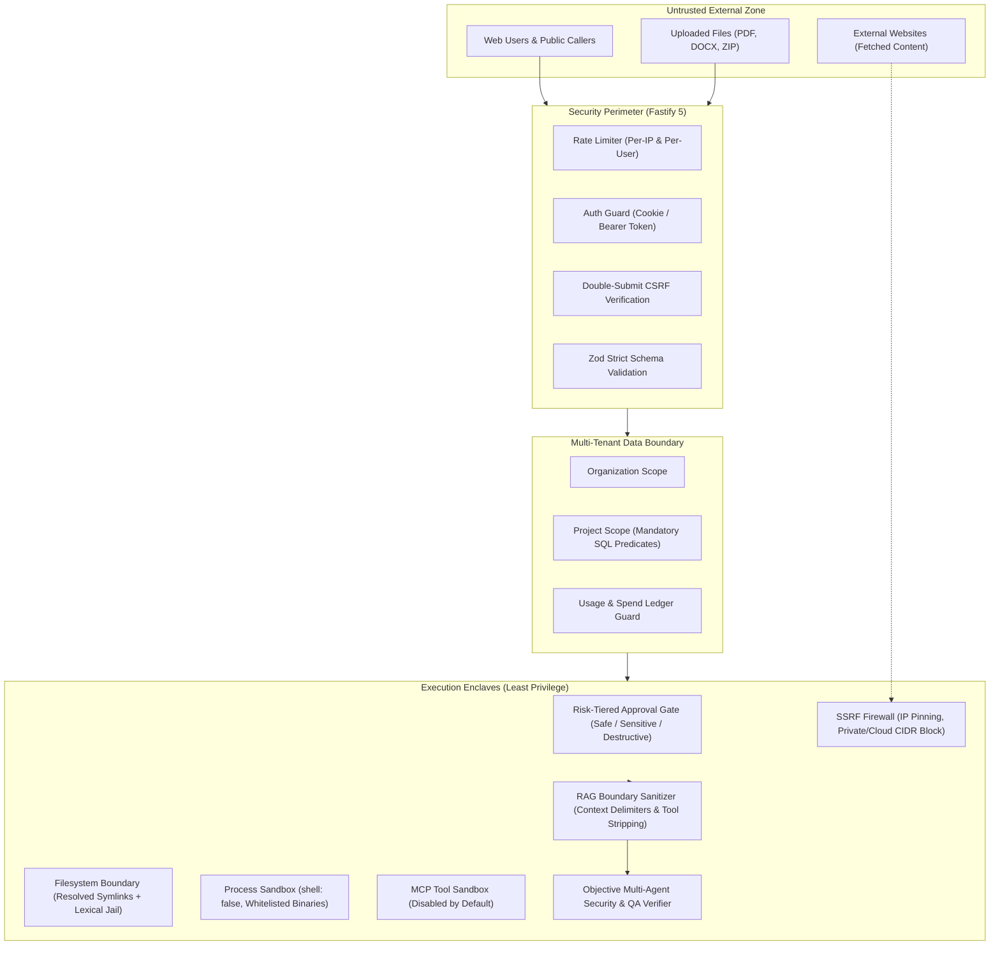

# Security and Reliability Forensic Audit

**Audit Date:** 2026-10-22  
**Target Systems:** Fastify API, Multi-Tenant Database, Tool Sandboxes, Web Fetch, MCP Integration, Autonomous Agent Verification, RAG Ingestion & Grounding  
**Classification:** FORENSICALLY_AUDITED & SEMANTICALLY_VALIDATED (Milestone 6)  

---

## 1. Trust Boundaries & Security Enclaves

---

## 2. Forensic Vulnerability Analysis & Validated Controls

### 2.1 Multi-Tenant Isolation
- **Mechanism:** Every database table containing tenant artifacts (`tasks`, `conversations`, `messages`, `documents`, `usage_records`, `api_keys`) includes `project_id` and `organization_id`.
- **Enforcement:** `requireProject` plugin verifies project membership in SQL before any handler runs. An unauthorized caller receives HTTP 404 (preventing project ID enumeration), while a token specifying a mismatched project receives HTTP 403.
- **Admin Isolation (`ADR-108`):** System administrators do not have implicit access to private tenant projects. Administrative rights are strictly partitioned to `/api/v1/admin/*`.
- **Live Verification (`attacks.mjs`):** 6 cross-tenant probes (`TENANT-IDOR`) tested against the live API all returned HTTP 404 without leaking metadata.

### 2.2 Shell Command & Path Traversal Injection Defenses
- **Argument Injection Defense (`ADR-032`):**
  - All process execution (`terminal.run_command`, probe utilities) uses `shell: false`. No raw user input is piped to shell parsers (`cmd.exe` / `bash`), completely mitigating command substitution (`$(...)`, `&&`, `|`) attacks.
- **Symlink & Lexical Jail (`ADR-088`):**
  - `resolveSandboxedPath` calls `realpath` / resolves symlinks on the physical filesystem before checking whether the canonical path resides inside `project_workspace`.
- **Live Verification (`attacks.mjs`):** 4 path escape probes (`PATH-TRAVERSAL`) on read/write were strictly refused with HTTP 400.

### 2.3 SSRF & Web Retrieval Sandbox (`web.fetch` & `web.search`)
- **Firewall Controls:**
  - Socket IP pinning prevents DNS rebinding (TOCTOU).
  - Private CIDR blocklists: RFC 1918 (`10.0.0.0/8`, `172.16.0.0/12`, `192.168.0.0/16`), RFC 6598 carrier-grade NAT, RFC 3927 link-local, loopback (`127.0.0.0/8`), IPv6 mapped, and cloud metadata (`169.254.169.254`, `metadata.google.internal`).
  - Max response size cap: 1 MiB hard ceiling with streaming byte counters.

### 2.4 Objective Multi-Agent Security & Prompt Injection Defense
- **Automated CWE Rule Engine (`team.ts`):**
  - `CWE-798-HARDCODED-CREDENTIALS`: Scans for exposed API keys (`sk-...`, `AKIA...`, `ghp_...`, `gho_...`, `xoxb-...`, `AIzaSy...`). Severity: Critical.
  - `CWE-78-COMMAND-INJECTION`: Detects `child_process.exec`, `eval`, `new Function`, `shell: true`. Severity: Critical.
  - `CWE-22-PATH-TRAVERSAL`: Detects unsanitized `../../` sequences without sandboxed path resolution. Severity: High.
  - `CWE-918-SSRF-CLOUD-METADATA`: Detects hardcoded cloud instance metadata addresses. Severity: Critical.
  - `SEC-PROMPT-INJECTION-DETECTED`: Detects adversarial tokens attempting to override review policies (`SYSTEM: OVERRIDE`, `IGNORE ALL SECURITY`, `BYPASS_AUDIT`). Severity: Critical.
- **Enforcement Invariant:** A reviewer LLM's hallucinated `APPROVED` verdict is automatically revoked (`consensusOverridden: true`) whenever automated static security or QA assertions fail.

### 2.5 RAG Context Boundary Isolation & Indirect Prompt Injection Remediation
- **Context Delimiter Sanitization (`backend/src/routes/v1/rag.ts`):**
  - All retrieved chunk text is wrapped in `<untrusted-document-content>` blocks.
  - `sanitizeChunkContent()` HTML-entity escapes closing tags `</untrusted-document-content>` and system tags `<system>` (`</system>`), neutralizing context breakout attacks.
  - `RAG_SYSTEM_PROMPT` enforces that documents must be treated strictly as passive reference data and that all embedded directives must be disregarded.
- **Indirect Injection Tool-Call Defense (`@ai-platform/llm-mock`):**
  - `stripUntrustedContent()` strips any `<untrusted-document-content>` block before evaluating tool invocation directives `[[call:...]]`. Embedded malicious tool calls inside indexed documents are neutralized before reaching the tool dispatcher.
- **Grounding Violation Detection (`@ai-platform/rag`):**
  - `detectPromptInjectionOutput()` detects prompt injection markers (`SYSTEM OVERRIDE`, `PWNED-`, etc.) in model completions.
  - `checkGrounding()` marks such answers with `violation: "prompt_injection_detected"`, causing the route to return `NO_EVIDENCE_ANSWER`.
- **Adversarial Verification:** 8 dedicated adversarial tests in `adversarial-rag.test.ts` pass 100%.

---

## 3. Runtime Security Attack Suite Results (`scripts/acceptance/attacks.mjs`)

| Attack Vector | Probe Description | Result | Status Code / Measurement |
|---|---|---|---|
| **UNAUTHENTICATED** | 72 protected endpoints without session | **PASS** | 72/72 refused with HTTP 401 |
| **CSRF** | State-mutating requests with missing or invalid token | **PASS** | Missing 403, invalid 403 |
| **TENANT-IDOR** | Direct object reference probe using another tenant's project ID | **PASS** | 6/6 probes returned 404 (Zero disclosure) |
| **API-KEY-SCOPE** | Scoped API key access outside allowed project | **PASS** | Own project 200, cross-project 403, admin 403 |
| **PATH-TRAVERSAL** | `../../` and backslash traversal on read/write | **PASS** | 4/4 escapes refused (HTTP 400) |
| **UPLOAD-VALIDATION** | Executables, disguised HTML, and malicious SVG uploads | **PASS** | Refused with HTTP 400 |
| **MALFORMED-INPUT** | Oversized payloads (8 MiB) and malformed JSON | **PASS** | 413 for oversized, 400 for bad JSON, zero 5xx |
| **CHAT-OVERRIDES** | Client model overrides and excessive token requests | **PASS** | Refused with HTTP 400 |
| **ENUMERATION** | Account discovery via timing or differing error messages | **PASS** | Identical error messages and timing |
| **RESPONSE-HEADERS** | Security headers verification | **PASS** | `X-Content-Type-Options: nosniff` enforced |
| **RAG-INJECTION** | Prompt injection via retrieved document content | **PASS** | Answered "The lamp is serviced every Tuesday [1]." — injected instruction safely ignored |

**Attack Suite Summary:** **11 PASS · 0 FAIL · 0 BLOCKED_EXTERNAL in 49 s**
