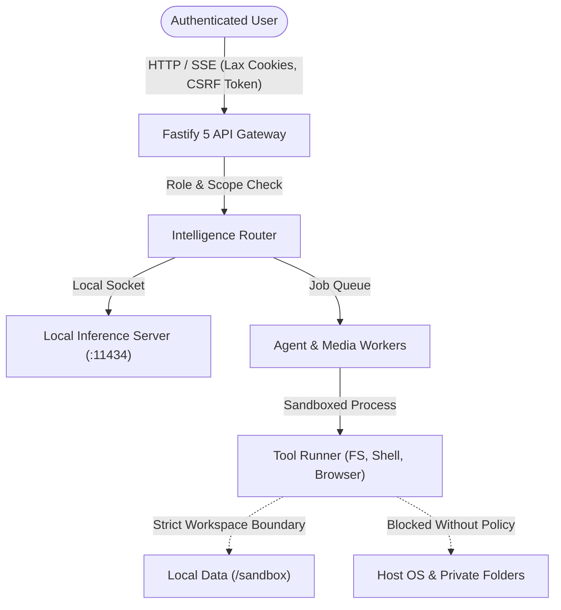

# NirnayAI — Security & Privacy Threat Model

**Document ID:** `docs/33_SECURITY_AND_PRIVACY_THREAT_MODEL.md`  
**Milestone:** 9 — Fully Independent, Self-Hosted, Multimodal Autonomous AI Platform  
**Classification:** Internal Engineering Standard  

---

## 1. System Overview & Security Posture

NirnayAI is designed as an **autonomous, self-hosted, user-controlled AI platform**. Because it operates directly on host infrastructure with capabilities including terminal command execution, filesystem manipulation, browser research, and document extraction, it has a significantly broader attack surface than a traditional text-only chat interface.

### Core Security Mandates:
1. **Zero External Data Exfiltration:** Model prompts, retrieved RAG contexts, uploaded documents, conversation history, and tool outputs must never leave the host environment unless explicitly authorized by the user for external web research.
2. **Untrusted Data Boundary:** All content originating from outside the security perimeter (user uploads, third-party web pages visited by the browser agent, external API responses, and generated model outputs) is treated as **untrusted data**.
3. **No Unchecked Agent Autonomy:** An agent cannot grant itself permissions, bypass workspace boundaries, or execute destructive operating-system commands without human-in-the-loop approval.

---

## 2. Threat Modeling Matrix (STRIDE Analysis)



| STRIDE Category | Potential Vulnerability / Threat Scenario | Impact | Applied Defensive Mitigations in NirnayAI |
| :--- | :--- | :--- | :--- |
| **Spoofing** | Unauthorized user assumes identity or bypasses session authentication | Unauthorized access to projects and memories | Argon2id password hashing, HTTP-only SameSite=Lax session cookies, cryptographically signed CSRF tokens, strict tenant isolation via `requireProject`. |
| **Tampering** | Indirect prompt injection embedded within uploaded PDF or researched webpage altering agent instructions | Agent executes unauthorized actions or leaks data | Delimited ChatML framing, strict separation of `system`, `user`, and `tool` contexts; model outputs passed to tools undergo strict JSON schema validation before execution. |
| **Repudiation** | An operator or agent modifies files or deletes databases without audit trail | Indefensible incident investigations | All sensitive tool executions, file edits, shell commands, and model calls are written to immutable append-only audit logs in the database. |
| **Information Disclosure** | Hardcoded secrets, API tokens, or user credentials leaking into application logs | Credential compromise | Automated dynamic regex and schema-driven redaction (`log-redaction.ts`) masks all sensitive tokens (`API_KEY`, `PASSWORD`, `DATABASE_URL`, `TOKEN`) before emission. |
| **Denial of Service** | Malicious recursive agent loop or huge file processing crashing host memory | Host exhaustion (OOM on 6 GB RAM host) | Token budget caps (`CHAT_MAX_OUTPUT_TOKENS`), job timeout deadlines (`expireInSeconds`), process concurrency caps, and rate-limiting middleware (`AUTH_RATE_LIMIT_MAX`). |
| **Elevation of Privilege** | Coding agent uses path traversal (`../../`) or unrestricted shell commands to escape sandbox | Host compromise | Scoped sandbox directories (`data/sandbox`), strict path normalization with forbidden prefix checks, command allowlisting, and mandatory human confirmation for destructive shell commands. |

---

## 3. Sandboxed Execution & Tool Security Boundaries

### 3.1 Local Filesystem Boundary Rules
1. **Workspace Confinement:** All agent file operations (create, read, update, delete) are strictly restricted to `SANDBOX_ROOT` (`./data/sandbox` or designated project directories).
2. **Path Traversal Defense:** Every input path is resolved using `path.resolve` and verified with `path.relative`:
   ```typescript
   function validateSafePath(root: string, targetPath: string): string {
     const resolved = path.resolve(root, targetPath);
     const relative = path.relative(root, resolved);
     if (relative.startsWith("..") || path.isAbsolute(relative)) {
       throw new PermissionError(`Access denied: path "${targetPath}" is outside the authorized workspace.`);
     }
     return resolved;
   }
   ```
3. **Protected Host Directories:** The agent is strictly prohibited from touching:
   - Operating system roots (`C:\Windows`, `/etc`, `/sys`, `/proc`)
   - User credential stores (`.ssh`, `.aws`, `.gnupg`, AppData, `%USERPROFILE%`)
   - Git repository internals (`.git/hooks`, `.git/config`)

### 3.2 Shell & Terminal Policy
1. **Command Allowlists:** Safe commands (`git status`, `git diff`, `npm test`, `npm run build`, `python`, `pytest`) are permitted automatically inside project worktrees.
2. **Approval Gate for Consequential Commands:** Any command containing destructive patterns (`rm -rf`, `format`, `del /s`, `drop database`, `kill`, `shutdown`, `chmod -R`) requires an explicit approval request from the user before execution.
3. **Timeout Ceiling:** Terminal commands run with strict timeouts (default: 30–60 seconds) to prevent frozen child processes from locking CPU resources.

---

## 4. Browser Agent Security & Anti-Phishing Controls

1. **No Credential Harvesting:** The browser automation agent is forbidden from saving or inputting passwords, payment details, or credentials unless explicitly directed in a human-attended session.
2. **No Paywall / CAPTCHA Bypassing:** The browser agent behaves in strict compliance with standard HTTP client protocols and robots.txt.
3. **Untrusted Page Context Sanitization:** Web page HTML extracted by the browser agent is stripped of active script tags (`<script>`, `<iframe>`, `javascript:`, `data:`) before being fed into the model reasoning pipeline to neutralize prompt injection vectors.

---

## 5. Privacy Guarantees & Host Independence

1. **100% Offline Capability:** All core operations (chat inference, persistent memory, document parsing, speech generation, coding tasks) run locally without making outbound network connections.
2. **Zero Telemetry:** NirnayAI emits no anonymous usage statistics, error crash dumps, or telemetry pings to third parties.
3. **User Memory Scoping:** Persistent user memory records are attributable to project IDs and user IDs, with explicit UI controls allowing users to view, inspect, modify, and permanently purge any stored fact or conversation trace.
