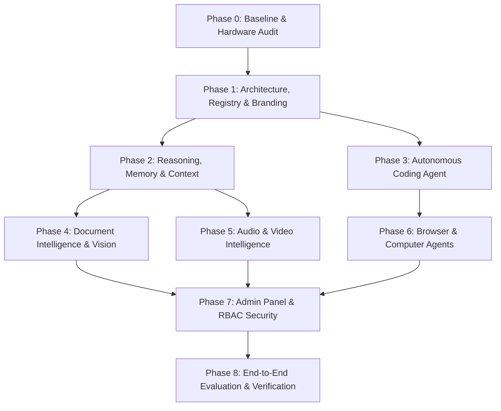

# NirnayAI — Milestone 9 Implementation Plan

**Document ID:** `docs/35_MILESTONE_9_IMPLEMENTATION_PLAN.md`  
**Milestone:** 9 — Fully Independent, Self-Hosted, Multimodal Autonomous AI Platform  
**Target Completion:** Current Session  

---

## 1. Roadmap & Phased Execution Overview

---

## 2. Phase-by-Phase Execution Details

### Phase 0 — Baseline Audit & Hardware Discovery (COMPLETED)
- Conducted WMI hardware audit: Windows 11, AMD Ryzen 3 3250U (4 threads), 6.0 GB RAM, AMD Radeon 2GB shared APU, 66.5 GB free SSD.
- Discovered Python 3.11 environment with `pymupdf`, `reportlab`, `python-docx`, `openpyxl`, `pillow`, `opencv-python`, `moviepy`, `selenium`.
- Validated native Windows SAPI speech synthesis (`System.Speech.Synthesis`) producing verified offline audio files.
- Published `docs/32_HARDWARE_AND_DEPLOYMENT_ASSESSMENT.md`, `docs/33_SECURITY_AND_PRIVACY_THREAT_MODEL.md`, and `docs/34_IP_AND_MODEL_LICENCE_REGISTER.md`.

### Phase 1 — Architecture, Registry & Branding
- Elevate branding to **NirnayAI** across UI layout, metadata, chrome navigation, headers, and documentation.
- Establish the Model Registry service cataloging model capabilities, context windows, quantization, hardware requirements, and online/offline status.
- Implement the Model Router dynamically mapping task types (Fast Chat, Complex Reasoning, Coding, Document Processing) to available local runtimes.
- Configure `SPEECH_PROVIDER=sapi` in `backend/.env` for native offline audio synthesis.
- Publish `docs/37_MODEL_REGISTRY_AND_BENCHMARKS.md`.

### Phase 2 — Chat, Reasoning, Memory & Context
- Verify persistent conversation history and user-controlled memory deletion in frontend (`/memory`) and API (`/api/v1/memory`).
- Implement long conversation summarization and context compression to protect the 8,192 token window on local models.
- Implement structured task classification and reasoning planning for complex multi-step queries.

### Phase 3 — Autonomous Coding Agent
- Construct sandboxed coding runner within `SANDBOX_ROOT` (`data/sandbox`).
- Support file search, reading, writing, refactoring, test execution, and Git diff generation.
- Implement safety approvals: prevent destructive operations, redact secrets, show diffs before changes, and provide rollback capability.
- Publish `docs/38_AGENT_SECURITY_AND_PERMISSION_DESIGN.md`.

### Phase 4 — Document Intelligence & Vision Engine
- Implement real document operations:
  - PDF reading (PyMuPDF) and generation (ReportLab) with structured validation.
  - Word document creation (python-docx) with heading, table, and bullet formatting.
  - Excel workbook creation (openpyxl) with formulas and tabular data.
- Implement real image analysis and structural OCR (Pillow, OpenCV).
- Re-open generated files to prove integrity and validity.

### Phase 5 — Audio & Video Intelligence Engine
- Activate native offline speech synthesis (Windows SAPI) generating real WAV files.
- Implement speech-to-text / transcription processing for audio files.
- Implement video frame extraction, scene segmentation, and timestamp-based summarization (MoviePy, OpenCV).
- Maintain clear distinction: video understanding is verified live; text-to-video generation is documented with hardware limits.

### Phase 6 — Browser Research & Computer/File Access Agents
- Implement browser research agent utilizing Playwright / Chromium for search, page extraction, and source citation.
- Implement scoped file search and editing within authorized project workspaces.
- Enforce human-in-the-loop approval checkpoints for high-impact actions.

### Phase 7 — Admin Panel, RBAC & Security Control Center
- Implement Admin dashboard in frontend (`/admin`) and backend (`/api/v1/admin`) with role-based access control (Super Admin, Admin, Developer, Operator, User).
- Provide granular controls to toggle individual models, agents, and tool permissions.
- Provide live audit logging viewer, system health metrics, and pending approval queue.

### Phase 8 — Integration, Evaluation & Release Readiness
- Execute comprehensive end-to-end acceptance suite testing every claimed capability.
- Deliver:
  - `docs/36_CURRENT_CAPABILITY_MATRIX.md` (updated with empirical results).
  - `docs/39_END_TO_END_TEST_REPORT.md`.
  - `docs/40_DEPLOYMENT_AND_HARDWARE_GUIDE.md`.
  - `docs/41_KNOWN_LIMITATIONS_AND_NEXT_MILESTONES.md`.
  - `MILESTONE_9_VERIFICATION_AND_RELEASE_REPORT.md`.
- Safely commit and push to `antigravity/universal-agent`.
