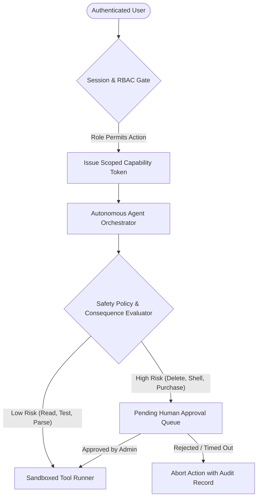

# NirnayAI — Agent Security & Permission Design

**Document ID:** `docs/38_AGENT_SECURITY_AND_PERMISSION_DESIGN.md`  
**Milestone:** 9 — Fully Independent, Self-Hosted, Multimodal Autonomous AI Platform  
**Classification:** Core System Architecture Specification  

---

## 1. Multi-Tier Permission Architecture

NirnayAI combines **Role-Based Access Control (RBAC)** at the user authentication layer with **Capability-Based Permission Tokens** at the agent orchestration layer.



---

## 2. Granular Capability Scopes

Every agent task is bound to a cryptographically verifiable capability context:

| Capability Scope | Description | Permitted Roles | Approval Required? |
| :--- | :--- | :--- | :--- |
| **`chat:interact`** | Send prompts, receive streaming inference, multi-turn chat | All authenticated users | No |
| **`memory:manage`** | View, edit, and delete personal memories | All authenticated users | No |
| **`document:process`**| Upload, parse, and generate PDF, DOCX, XLSX documents | Standard User and above | No |
| **`media:synthesize`**| Generate speech audio via SAPI TTS | Standard User and above | No |
| **`coding:read`** | Search project directory, read source code | Developer, Admin, Super Admin | No |
| **`coding:patch`** | Write, edit, and refactor code inside sandbox | Developer, Admin, Super Admin | No (Within sandbox) |
| **`shell:execute`** | Run allowed test runners (`npm test`, `python -m unittest`) | Developer, Admin, Super Admin | No (Allowlisted only) |
| **`shell:consequential`**| High-impact terminal commands (`rm`, `format`, `shutdown`) | Admin, Super Admin | **YES (Mandatory)** |
| **`browser:research`**| Fetch and summarize public web documentation | Developer, Admin, Super Admin | No (Sanitized mode) |
| **`browser:consequential`**| Form submission, public posting, payment processing | Admin, Super Admin | **YES (Mandatory)** |
| **`admin:configure`** | Toggle models, agents, manage users, trigger backups | Admin, Super Admin | No |

---

## 3. Human-in-the-Loop Consequential Action Protocol

When an agent proposes an action flagged as consequential:
1. **Execution Freeze:** The agent step pauses; no subprocess or network write is performed.
2. **Approval Ticket Created:** An approval ticket containing:
   - Proposed action (`action_type`)
   - Target resource (`file_path`, `url`, `command_string`)
   - Unified diff or command parameters
   - Risk justification
   is written to `approval_queue` and surfaced on the Admin Dashboard (`/admin`).
3. **Operator Decision:**
   - If **Approved**, the execution engine resumes and executes the specific approved step.
   - If **Rejected**, the agent receives a `PermissionDeniedError`, updates its internal plan, and provides an alternative safe course of action.
   - If **Timed Out** (default: 300 seconds), the action is automatically cancelled.

---

## 4. Multi-Agent Collaboration & Controlled State Sharing

Tasks requiring cross-specialist coordination follow a strict five-stage pipeline:

```
[User Goal] 
   └── 1. PLANNER AGENT: Deconstructs goal into ordered DAG of subtasks.
   └── 2. PERMISSION AUDITOR: Evaluates capability scopes against user credentials.
   └── 3. SPECIALIST AGENTS: Execute parallel or sequential steps:
          - Research Agent (collects facts/citations)
          - Coding Agent (creates/tests code in sandbox)
          - Document Agent (compiles final executive PDF/DOCX)
   └── 4. VERIFICATION AGENT: Validates file outputs, test suite exit codes, and assertions.
   └── 5. SYNTHESIS AGENT: Compiles transparent result evidence for the user.
```

### State Isolation Rules:
* Specialist agents communicate exclusively through structured JSON event buses.
* No agent is allowed to access the process memory or execution thread of another agent.
* Every state transition is recorded in the platform's immutable audit log.
