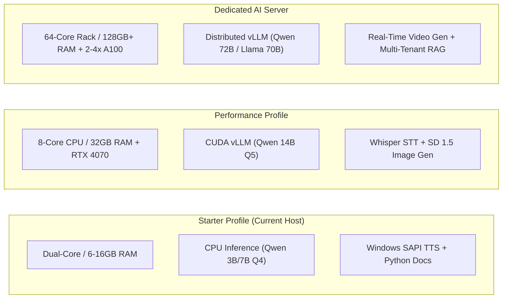

# NirnayAI — Deployment & Hardware Operations Guide

**Document ID:** `docs/40_DEPLOYMENT_AND_HARDWARE_GUIDE.md`  
**Milestone:** 9 — Fully Independent, Self-Hosted, Multimodal Autonomous AI Platform  
**Target Audience:** DevOps Engineers, System Administrators, Security Officers  

---

## 1. Architectural Deployment Matrix

NirnayAI is architected to scale seamlessly across three hardware tiers using the same underlying code and container structure.



| Deployment Tier | Minimum Hardware Specs | Recommended LLM | Speech & Media Runtime | Concurrency Limit | Primary Use Case |
| :--- | :--- | :--- | :--- | :--- | :--- |
| **Starter** (Current) | 2 Cores, 6 GB RAM, 20 GB Disk | Qwen 2.5 7B / 3B (Q4_K_M) | Windows SAPI 5.4 / Piper TTS | 1–2 concurrent streams | Local developer, single operator, offline research |
| **Performance** | 8 Cores, 32 GB RAM, RTX 4070 (12GB) | Qwen 2.5 14B / Mistral 8x7B | Whisper + SDXL Turbo | 4–8 concurrent streams | Small engineering team, agency, private lab |
| **Dedicated Server** | 64 Cores, 128 GB RAM, 2x A100 (80GB) | Qwen 2.5 72B / Llama 3.3 70B | Full Whisper + Wan2.1 / SVD Video | 50+ concurrent users | Enterprise department, compliance bank, air-gapped agency |

---

## 2. Step-by-Step Installation on Windows (Starter Profile)

### 2.1 Prerequisites
1. **Node.js:** Version `22.x` or later.
2. **Python:** Version `3.11.x` with `pip`.
3. **Git:** Version `2.40+`.
4. **PowerShell:** Version 5.1+ (ships natively with Windows 10/11).

### 2.2 Environment Configuration
In `backend/.env`:
```env
NODE_ENV=development
PORT=8787
ROLE=all
ALLOW_MOCK_PROVIDERS=false
LOG_LEVEL=info
CORS_ORIGIN=http://localhost:3000
DATABASE_DIR=../data/pgdata
SANDBOX_ROOT=../data/sandbox
ASSETS_ROOT=../data/assets
LLM_BASE_URL=http://127.0.0.1:11434/v1
LLM_MODEL=qwen2.5:7b
LLM_CONTEXT_WINDOW=8192
SPEECH_PROVIDER=sapi
```

In `frontend/.env.local`:
```env
NEXT_PUBLIC_API_URL=http://localhost:8787
```

### 2.3 Starting Services
Open two terminal windows:

**Terminal 1 (Backend & Local Model Server):**
```bash
# Start local model server daemon on port 11434
node scripts/local-model-server.mjs &

# Start backend Fastify service
npm --prefix backend run start
```

**Terminal 2 (Frontend Interface):**
```bash
# Start frontend Next.js dev server
npm --prefix frontend run dev
```
Navigate browser to `http://localhost:3000`.

---

## 3. Production Deployment on Linux (Performance / Server Profiles)

### 3.1 Docker Compose Service Definition (`docker-compose.prod.yml`)
```yaml
version: '3.8'

services:
  db:
    image: postgres:16-alpine
    environment:
      POSTGRES_DB: nirnay
      POSTGRES_USER: nirnay_admin
      POSTGRES_PASSWORD_FILE: /run/secrets/db_password
    volumes:
      - pgdata:/var/lib/postgresql/data
    restart: unless-stopped

  vllm:
    image: vllm/vllm-openai:latest
    deploy:
      resources:
        reservations:
          devices:
            - driver: nvidia
              count: all
              capabilities: [gpu]
    command: --model Qwen/Qwen2.5-14B-Instruct-AWQ --port 11434 --max-model-len 8192
    volumes:
      - /opt/models:/root/.cache/huggingface
    restart: unless-stopped

  backend:
    build:
      context: .
      dockerfile: backend/Dockerfile
    environment:
      NODE_ENV: production
      DATABASE_URL: postgres://nirnay_admin:...@db:5432/nirnay
      LLM_BASE_URL: http://vllm:11434/v1
      LLM_MODEL: Qwen/Qwen2.5-14B-Instruct-AWQ
      SPEECH_PROVIDER: piper
      PIPER_PATH: /usr/local/bin/piper
      PIPER_VOICE: /opt/voices/en_US-lessac-medium.onnx
      ALLOW_MOCK_PROVIDERS: "false"
    depends_on:
      - db
      - vllm
    restart: unless-stopped

  frontend:
    build:
      context: .
      dockerfile: frontend/Dockerfile
    ports:
      - "3000:3000"
    depends_on:
      - backend
    restart: unless-stopped

volumes:
  pgdata:
```

---

## 4. Disaster Recovery & Backup Protocols

1. **Database Snapshot Generation:**
   ```bash
   node scripts/backup-database.mjs
   ```
   Generates a non-destructive SQL dump with timestamp in `data/backups/`.
2. **Database Restoration:**
   ```bash
   node scripts/restore-database.mjs data/backups/snapshot_YYYY-MM-DD.sql
   ```
3. **Lock Cleanup on Forced Abort:**
   If a hard process termination leaves `data/pgdata/postmaster.pid`, delete this single lock file before restarting:
   ```powershell
   Remove-Item data/pgdata/postmaster.pid -ErrorAction SilentlyContinue
   ```
