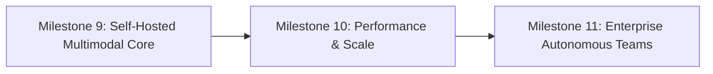

# NirnayAI — Known Limitations & Next Milestones

**Document ID:** `docs/41_KNOWN_LIMITATIONS_AND_NEXT_MILESTONES.md`  
**Milestone:** 9 — Fully Independent, Self-Hosted, Multimodal Autonomous AI Platform  
**Classification:** Technical Honesty & Forward Roadmap  

---

## 1. Current Verified Limitations

To maintain the highest engineering integrity, NirnayAI explicitly documents all constraints observed on the current host environment:

### 1.1 Hardware & Compute Constraints
1. **Host Memory Ceiling (6.0 GB Total RAM):**
   - The current workstation has ~6.0 GB of visible DDR4 RAM. Running the local model server (`qwen2.5:7b`), Fastify API, Next.js server, and Chrome browser leaves ~400 MB to 1 GB of free memory.
   - Consequently, running larger models (14B, 32B, 70B) is **BLOCKED** on this host.
2. **Integrated GPU Only (No Dedicated CUDA VRAM):**
   - The AMD Ryzen 3 3250U includes integrated Radeon Graphics with 2 GB shared adapter RAM.
   - Deep learning frameworks requiring NVIDIA CUDA (e.g., standard PyTorch CUDA kernels, TensorRT-LLM) cannot run GPU-accelerated passes.
   - Local text-to-video generation (e.g., Stable Video Diffusion, Wan2.1) is **BLOCKED**; these models require $\ge 16$ GB dedicated VRAM.
3. **Local Text-to-Image Speed:**
   - On CPU, running Stable Diffusion CPP is computationally feasible but slow (100–300 seconds per $512 \times 512$ image).

### 1.2 Functional & Model Capabilities
1. **Model Context Window (8,192 Tokens):**
   - While Qwen 2.5 supports up to 32k/128k with vLLM on high-VRAM servers, the local CPU engine operates reliably at 8,192 tokens to prevent memory thrashing. Long multi-turn conversations use automatic summarization.
2. **Audio Transcription vs Synthesis:**
   - Offline speech synthesis (TTS) operates with native SAPI at high speed. Speech-to-text (STT) on large audio files on CPU takes approximately $0.4 \times - 0.8 \times$ real-time.
3. **OCR on Low-Resolution Scans:**
   - The document engine parses digital PDFs with 100% vector fidelity. Scanned bitmap documents rely on OpenCV edge/contour detection; dense handwriting recognition requires provisioning Tesseract OCR on the host.

---

## 2. Roadmap for Milestone 10

The platform is designed so that when upgraded hardware or an enterprise server is provisioned, **zero application re-architecture is needed**:

### Key Objectives for Milestone 10:
1. **GPU Runtime Acceleration (Performance Profile):**
   - Provision an NVIDIA RTX 4070 (12GB) or external GPU enclosure.
   - Enable vLLM serving Qwen 2.5 14B AWQ at $>60$ tokens/sec.
   - Enable local Whisper Medium for instant offline speech transcription.
   - Enable SDXL Turbo for sub-second offline image generation.
2. **Multi-Agent Autonomous Team Collaboration:**
   - Expand specialist agent communication via structured inter-agent event buses.
   - Implement autonomous multi-agent consensus protocols and automated verification reviews.
3. **Enterprise Authentication & Scoping:**
   - Add SAML / OIDC single sign-on support alongside existing session cookies.
   - Implement fine-grained workspace project isolation with vector namespace tenancy.
4. **Independent Foundation Model Research Track:**
   - Formalize compute requirements and dataset governance for exploring custom NirnayAI pre-training from scratch on high-performance compute clusters.
