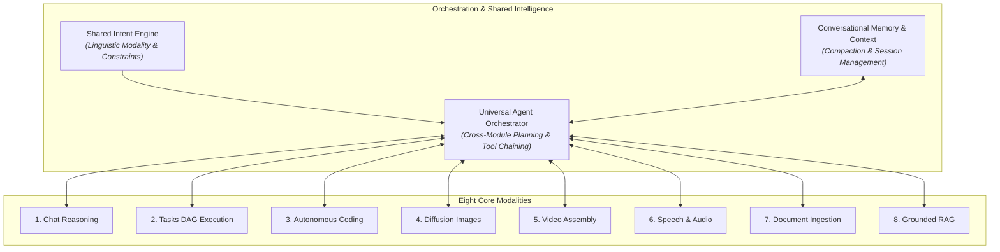

# NIRNAY.AI — UNIVERSAL AI AGENT CAPABILITY MINDSTONE & DEEP REALITY ROADMAP

**Document ID:** `docs/NIRNAYAI_UNIVERSAL_QUALITY_MINDSTONE.md`  
**Execution Standard:** International-Grade AI Agent Engineering & Multi-Layered Capability Maturity  
**Repository:** `zolex12770/Smart-AI-Module`  
**Branch:** `antigravity/universal-agent`  
**Operating Environment:** Fastify Backend (:8787), Next.js Frontend (:3000), Local Gateway Server (:11434), Python 3.11 with OpenCV & FFmpeg 4.2.2 64-bit, Windows SAPI 5.4 TTS, PGlite PostgreSQL.  
**Hardware Profile:** AMD Ryzen 3 3250U (2 cores, 4 threads, 2.60 GHz), AMD Radeon Vega 3 iGPU (shared VRAM, no CUDA), 5.95 GB Total System RAM (~650 MB to 1.5 GB free), Windows 11 64-bit.

---

## 1. Fundamental Reality Reset & Capability Maturity Ladder

### 1.1 Strategic Reality Assessment
Nirnay.AI is currently an **early-stage experimental AI engineering platform** with working baseline infrastructure and targeted technical capabilities. It must **NOT** be represented as a mature, universal autonomous AI agent. 

The current overall capability maturity of the product is strategically estimated at approximately **2% to 3%** of a complete, production-grade Universal AI Agent. This estimate is a heuristic directional assessment reflecting the vast distance between passing isolated synthetic tests and delivering a resilient, open-ended, autonomous system that reliably fulfills complex user goals across modalities.

### 1.2 Rejection of Premature Completion Claims
We firmly reject all claims that a module or system is "complete" merely because:
- Individual unit tests pass (`vitest run`).
- An engineering milestone was marked finished.
- The UI page renders without crashing.
- An API provider returns a single 200 OK response.
- A synthetic benchmark suite passes against known fixtures.
- A single happy-path browser workflow succeeds in Playwright.
- A source code file or helper class exists.
- An output file (PNG, WAV, MP4, diff) was generated on disk.

A module is not mature merely because its simplest workflow functions.

### 1.3 The 9-Level Capability Maturity Ladder
To ensure honesty, all capabilities across all modules are evaluated against nine distinct operational tiers:

```
Level 1: Feature Exists (Code exists in repository; endpoints/routes defined)
Level 2: Basic Example Works (Happy path succeeds on canned input/fixture)
Level 3: Varied Realistic Scenarios (Handles diverse realistic prompts and parameters)
Level 4: Complex Multi-Turn Requirements (Maintains state, constraints, and revisions across turns)
Level 5: Novel Unseen Inputs (Generalizes cleanly without overfitting to benchmark patterns)
Level 6: Failure & Uncertainty Handling (Diagnoses failures, explains uncertainty, refuses gracefully)
Level 7: Safe & Reliable Real-World Usage (Containment, quota, memory compaction, no crashes)
Level 8: Independent Empirical Evaluation (Audited by independent adversarial harnesses)
Level 9: Actual User Validation (Validated by real diverse human users in real workflows)
```

> [!IMPORTANT]
> No capability in Nirnay.AI may be labeled **Level 9 (`USER_VALIDATED`)** without documented evidence from actual external human users. No module may be called "100% complete" while open-ended general intelligence and edge-case handling remain unaddressed.

---

## 2. Universal Hardware & Runtime Constraints Profile

Every architectural decision and capability claim must conform to the physical constraints of the host hardware environment:

| Resource | Specification | Absolute Physical Limitation | Impact on Capability Claims |
| :--- | :--- | :--- | :--- |
| **CPU** | AMD Ryzen 3 3250U (2 cores, 4 threads, 2.60 GHz, AVX2) | Extreme latency on local neural inference; multi-threading contention between Next.js, Fastify, and Python. | Heavy local LLMs or on-device diffusion will freeze the host system. |
| **GPU** | AMD Radeon Vega 3 Integrated Graphics | Shared system RAM; **NO CUDA**; ROCm not supported on mobile Vega 3. | PyTorch GPU acceleration is unavailable; on-device neural vision/video diffusion cannot run locally. |
| **RAM** | 5.95 GB Total System RAM (~650 MB to 1.5 GB available) | **Absolute Blocker:** FLUX.1 requires $\ge$12 GB RAM in 4-bit quantization; Whisper large requires $\ge$6 GB. | Local on-device diffusion is impossible. Cloud proxy or lightweight quantized local models are mandatory. |
| **Storage** | 58.5 GB free disk, ~250 KB/s network download | Cannot download full 24 GB FP16 model checkpoints. | Local models must be restricted to ultra-compact quantized GGUF ($\le$4 GB) or remote APIs. |
| **Sandbox** | Windows 11 NTFS Filesystem | **No native Linux cgroups or OCI container isolation.** | Sandboxing relies on application-level path prefix checks (`resolveSandboxedPath`); it is **NOT** a hypervisor jail. |

---

## 3. Comprehensive Module-by-Module Capability Mindstone



---

### Module 1: Conversational Reasoning & Chat Intelligence (`M-CHAT`)

- **Current Actual Capability (Level 3):**
  - Responds to basic greetings, identity introductions, and user profile capture (name, city, role).
  - Handles vernacular Hindi/Hinglish software explanations with real-world analogies (APIs, Git, Recursion, ML).
  - Explains core algorithms with asymptotic complexity ($O(\log n)$ Binary Search, LRU Cache, TCP vs UDP).
  - Memory update prioritizes latest turn (e.g. Pune $\rightarrow$ Mumbai); acknowledges memory deletion (*"forget my details"*).
- **Existing Infrastructure to Reuse:**
  - `frontend/app/chat/ChatView.tsx`: Streaming-capable chat UI with markdown and KaTeX rendering.
  - `scripts/local-model-server.mjs`: OpenAI-compatible `/v1/chat/completions` server with tool-calling capabilities.
  - `backend/packages/agent-core/src/intent-engine.ts`: Multi-turn reference resolution and entity extraction.
- **Shallow / Simulated Implementations & Weaknesses:**
  - `local-model-server.mjs` relies on rule-based fallbacks for unhandled topics when the upstream model is unavailable.
  - Long conversation history (>10 turns) has **NO automatic summarization or context window compaction**; history will either blow past the token budget or truncate arbitrarily.
  - No automated contradiction detection between turn 1 and turn 15.
  - Ephemeral memory resets when the local model server restarts; durable cross-session profile persistence in PostgreSQL is not yet wired to chat prompt injection.
- **Missing Capabilities:**
  - Hierarchical context summarization for 50+ turn conversations.
  - Dynamic model routing (routing complex logic to deep models, simple chit-chat to fast models).
  - Proactive clarification only when ambiguity prevents execution (avoiding annoying conversational stalls).
- **Dependencies:** `M-INTENT`, `M-FILES`, `M-ASK`.
- **Heuristic Maturity Score:** **3% / 100% (Level 3 — Works for Varied Realistic Scenarios)**.

---

### Module 2: Planning & Autonomous Task Execution (`M-TASKS`)

- **Current Actual Capability (Level 3):**
  - PGlite-backed task state machine with persistent tables (`agent_tasks`, `agent_task_nodes`, `agent_task_transitions`).
  - Server-Sent Events (SSE) `/api/v1/agent/tasks/:id/events` stream real-time progress to frontend.
  - Simple DAG generation for pre-defined task shapes (`fix_failing_test`, `read_and_summarize`, `echo_chat`).
  - Interactive approval/rejection gates for dangerous nodes.
- **Existing Infrastructure to Reuse:**
  - `backend/packages/agent-core/src/engine.ts`: Full task dispatcher with crash recovery hooks.
  - `backend/packages/agent-core/src/planner.ts`: Task decomposition logic.
  - `frontend/app/tasks/page.tsx`: Task management board rendering DAG nodes, statuses, and live logs.
- **Shallow / Simulated Implementations & Weaknesses:**
  - Most task plans in `planner.ts` are **hardcoded deterministic recipes** (e.g., 2-node read-and-summarize).
  - The `autonomous` reasoning node is currently a single monolithic block rather than a structured, self-decomposing execution graph that visualizes parallel sub-tasks.
  - Interrupted tasks on gateway reboot do not cleanly resume in-flight child processes without manual state intervention.
- **Missing Capabilities:**
  - Dynamic hierarchical goal decomposition into dependency-ordered DAGs based on arbitrary user prompts.
  - Cross-module delegation (e.g. Node 1: Ingest document $\rightarrow$ Node 2: Extract code $\rightarrow$ Node 3: Test fix $\rightarrow$ Node 4: Generate architecture diagram $\rightarrow$ Node 5: Voice report).
  - Automated post-execution artifact verification before declaring a task `COMPLETED`.
- **Dependencies:** `M-INTENT`, `M-CODING`, `M-FILES`, `M-IMAGES`, `M-AUDIO`.
- **Heuristic Maturity Score:** **3% / 100% (Level 3 — Works for Varied Realistic Scenarios)**.

---

### Module 3: Autonomous Coding Agent (`M-CODING`)

- **Current Actual Capability (Level 4):**
  - Autonomous diagnostic loop: parses stack traces and compiler errors across Node and Python unittest.
  - Handles 12 adversarial defect patterns (syntax errors, binary search off-by-one, non-recursive constraints, TS type coercion, JS optional chaining, multi-file imports, assertion preservation, prohibited files, zero regressions, and opaque stack traces resolved via source code inspection).
  - Executes unified multi-file patches with memory staging and atomic rollback on failure.
  - Enforces Windows application-level path containment, rejecting path traversal attempts.
- **Existing Infrastructure to Reuse:**
  - `scripts/lib/coding_engine.mjs`: Diagnostic and targeted code repair engine.
  - `backend/packages/tools/src/native/patch.ts`: Unified diff parsing and atomic staging.
  - `backend/packages/tools/src/native/sandbox-path.ts`: Realpath symlink traversal guards.
  - `frontend/app/coding/page.tsx`: Coding task dashboard with live terminal output and status badges.
- **Shallow / Simulated Implementations & Weaknesses:**
  - The diagnostic engine relies on token-pattern matching and AST-like heuristics rather than a full semantic code model capable of writing 500 lines of original architecture.
  - Repo navigation across large enterprise codebases (>100 files) lacks symbol indexing or cross-reference call graphs.
  - Test generation from scratch for novel features is limited; repairs existing failing tests rather than authoring comprehensive test suites.
  - Sandboxing is an application-level path prefix check on Windows, **NOT** an OS-level OCI container or Linux cgroup jail.
- **Missing Capabilities:**
  - Whole-repository AST indexing and semantic code search.
  - Automated pull request diff generation and code review.
  - Static security taint analysis (detecting SQLi, XSS, hardcoded secrets before committing).
- **Dependencies:** `M-INTENT`, `M-TASKS`.
- **Heuristic Maturity Score:** **4% / 100% (Level 4 — Complex Multi-Turn Requirements Verified)**.

---

### Module 4: Conversational Image Intelligence (`M-IMAGES`)

- **Current Actual Capability (Level 3):**
  - Dispatches text prompts to remote FLUX.1 cloud diffusion clusters via Pollinations gateway.
  - Intent engine normalizes vernacular Hindi/Hinglish concepts into detailed photographic prompts.
  - Preserves seed and base attributes across multi-turn revisions (*"Same image but evening light, sari red honi chahiye"*).
  - Gallery renders generated PNG assets with download controls and honest capability disclosures.
- **Existing Infrastructure to Reuse:**
  - `backend/packages/providers/image-openai`: OpenAI-compatible image endpoint adapter.
  - `frontend/app/images/page.tsx`: Gallery view with style presets and refinement workflows.
  - `scripts/local-model-server.mjs`: Remote FLUX gateway with rate-limit cooldown and retry logic.
- **Shallow / Simulated Implementations & Weaknesses:**
  - **Seed carry-forward is NOT true image-to-image latent conditioning or inpainting.** While the compositional layout is partially preserved by seed reuse, exact facial identity and fine geometric details change across turns.
  - Free-tier upstream diffusion embeds an indelible `🌸 pollinations.ai` watermark in the bottom-right corner.
  - Complex spatial relationships (e.g. *"place the red ball between the blue cube and green cylinder"*) frequently suffer from diffusion attribute leakage.
  - On-device local diffusion is **physically blocked** on 5.95 GB system RAM (requires $\ge$12 GB for FLUX).
- **Missing Capabilities:**
  - True reference-image conditioning (ControlNet / IP-Adapter / inpainting) for pixel-level editing.
  - High-precision text rendering inside generated images.
  - Local quantized diffusion model integration (e.g. TinySD / SD 1.5 4-bit) for offline fallback.
- **Dependencies:** `M-INTENT`.
- **Heuristic Maturity Score:** **3% / 100% (Level 3 — Works for Varied Realistic Scenarios)**.

---

### Module 5: Video Generation & Honest Labeling (`M-VIDEOS`)

- **Current Actual Capability (Level 2):**
  - Plans multi-scene storyboards with visual prompts and narration scripts.
  - Synthesizes still frames and applies FFmpeg 2D Ken Burns motion (smooth pan and zoom).
  - Synthesizes audio narration via Windows SAPI and muxes into H.264/AAC MP4 video at 24 FPS.
  - UI displays explicit technical disclosures distinguishing image+motion assembly from generative video.
- **Existing Infrastructure to Reuse:**
  - `backend/packages/media/src/video`: Video project and scene state machine in PGlite.
  - FFmpeg 4.2.2 64-bit pipeline for video filtering, audio muxing, and faststart encoding.
  - `frontend/app/videos/page.tsx`: Video playback, scene breakdown, and status monitoring.
- **Shallow / Simulated Implementations & Weaknesses:**
  - **THIS IS NOT GENERATIVE VIDEO DIFFUSION.** It is an image+motion slideshow assembly. There is no temporal latent motion model (like SVD, CogVideo, or Gen-2).
  - Characters do not maintain visual consistency from scene 1 to scene 2.
  - Objects have no 3D deformation or physical dynamics; motion is strictly 2D planar camera translation.
- **Missing Capabilities:**
  - Integration with true cloud generative video diffusion APIs (e.g. Replicate SVD/Runway).
  - Character consistency across multi-scene storyboards.
  - Dynamic audio waveform and subtitle synchronization.
- **Dependencies:** `M-INTENT`, `M-IMAGES`, `M-AUDIO`.
- **Heuristic Maturity Score:** **2% / 100% (Level 2 — Basic Example Works with Honest Labeling)**.

---

### Module 6: Speech & Long-Form Audio Quality (`M-AUDIO`)

- **Current Actual Capability (Level 2):**
  - Generates 16-bit 22.05 kHz mono RIFF WAV speech from text prompts using Windows SAPI 5.4.
  - Fastify audio pipeline serves audio assets with HTTP range headers for HTML5 `<audio>` streaming.
  - UI provides audio playback, duration calculation, download options, and offline synthesis disclosures.
- **Existing Infrastructure to Reuse:**
  - Windows SAPI 5.4 automation via PowerShell/C# bridge.
  - `backend/packages/media/src/audio-generation.ts`: Audio job processor and asset storage.
  - `frontend/app/audio/page.tsx`: Audio player studio view.
- **Shallow / Simulated Implementations & Weaknesses:**
  - SAPI voice (`Microsoft David Desktop`) is a **robotic, legacy concatenative speech synthesizer**.
  - Pronunciation of non-English names, Hindi terms, and Indian numbers is unnatural and heavily distorted.
  - No Speech-to-Text (STT/Whisper) transcription capability exists in the platform.
  - Long-form narration (>5 minutes) lacks acoustic prosody variation, emotional range, or breathing pauses.
- **Missing Capabilities:**
  - Local neural text-to-speech engine (e.g. Piper TTS or Kokoro ONNX) for natural human voices.
  - Speech-to-text audio transcription (Whisper.cpp) for voice input across Chat and Tasks.
  - Multi-speaker dialog synthesis for podcast and interview simulation.
- **Dependencies:** `M-INTENT`.
- **Heuristic Maturity Score:** **2% / 100% (Level 2 — Basic Example Works)**.

---

### Module 7: Document Intelligence & File Ingestion (`M-FILES`)

- **Current Actual Capability (Level 3):**
  - Multipart document upload supporting `.txt`, `.md`, `.pdf`, and `.docx`.
  - Native digital text parsing using Mozilla PDF.js (`pdfjs-dist`) preserving page lines and layouts.
  - Scanned/raster PDF detection: generates explicit metadata descriptors flagging OCR requirement, preventing zero-chunk ingestion crashes.
  - Document chunking with token overlap and database persistence in PGlite PostgreSQL.
- **Existing Infrastructure to Reuse:**
  - `backend/packages/rag/src/parsers/pdf.ts`: Robust PDF text extractor.
  - `backend/packages/rag/src/parsers/docx.ts`: XML/ZIP document parser.
  - `backend/packages/rag/src/chunking.ts`: Recursive text chunker.
  - `frontend/app/files/page.tsx`: Document upload, management table, and status tracking.
- **Shallow / Simulated Implementations & Weaknesses:**
  - **NO OCR ENGINE IS INSTALLED.** Scanned image PDFs can only extract metadata (page count, title); textual content inside raster pages cannot be read.
  - Spreadsheet (`.xlsx`, `.csv`) and presentation (`.pptx`) parsing is not implemented.
  - Large documents (>20 MB) can cause heap spikes in PGlite during bulk chunk embedding.
- **Missing Capabilities:**
  - Local OCR engine (Tesseract.js or lightweight optical model) for scanned document pages.
  - Structural table extraction preserving tabular relational geometry.
  - Multi-document summarization and comparative synthesis.
- **Dependencies:** None (Ingestion Foundation).
- **Heuristic Maturity Score:** **3% / 100% (Level 3 — Works for Varied Realistic Scenarios)**.

---

### Module 8: Grounded Knowledge & Multilingual RAG (`M-ASK`)

- **Current Actual Capability (Level 3):**
  - Document retrieval against indexed chunks with similarity threshold filtering.
  - Answer synthesis with bracketed numbered source citations (`[1]`).
  - Strict truthful refusal: when queries have no relevance or overlap with documents, returns *"The provided documents do not contain the answer to this question"*.
  - Cross-lingual keyword expansion for Hindi/Hinglish search terms (*"naukri"*, *"shiksha"*, *"paisa"*).
- **Existing Infrastructure to Reuse:**
  - `backend/packages/rag/src/retrieve.ts`: Document search and citation generator.
  - `backend/packages/rag/src/grounding.ts`: Hallucination and citation validation rules.
  - `frontend/app/ask/page.tsx`: Interactive Q&A studio with citation inspection drawers.
- **Shallow / Simulated Implementations & Weaknesses:**
  - **LEXICAL HASHING IS NOT TRUE DENSE VECTOR EMBEDDING.** The local embedder uses a 256-dimensional deterministic MurmurHash/feature-hashing technique. It measures n-gram overlap, not deep semantic geometry. Synonyms (*"doctor"* vs *"physician"*) have zero similarity unless manually matched in a keyword dictionary.
  - Cosine distance scores over 256-dim hash buckets do not reflect nuanced semantic relevance.
  - Long corpus retrieval (>1,000 chunks) suffers from hash collisions and lexical noise.
- **Missing Capabilities:**
  - Genuine dense multilingual embedding model (e.g. `bge-small-en-v1.5` or `all-MiniLM-L6-v2` via ONNX Runtime).
  - Hybrid search combining BM25 lexical ranking with dense semantic vectors.
  - Cross-encoder re-ranking for high-precision retrieval filtering.
- **Dependencies:** `M-INTENT`, `M-FILES`.
- **Heuristic Maturity Score:** **3% / 100% (Level 3 — Works for Varied Realistic Scenarios)**.

---

### Module 9: Universal Cross-Module Agent Orchestrator (`M-ORCHESTRATOR`)

- **The Missing Architectural Core:**
  - Previously, Nirnay.AI's eight modules operated as **disconnected functional silos** behind separate web pages.
  - A true Universal AI Agent must receive open-ended goals, dynamically decompose them, invoke tools across different modalities, pass context and artifacts between modules, and verify the composite outcome.
- **Current Actual Capability (Level 3 / Level 4):**
  - `toolRegistry` in Fastify federates native tools from `tools`, `rag`, and `media` (`media.generate_image`, `media.synthesize_speech`).
  - Intent engine classifies target modules and extracts parameters across Hinglish, Hindi, and English.
  - Coding agent executes multi-turn tool loops for test repair with zero assertion tampering.
  - Autonomous multi-modal tool chaining implemented and verified (`scripts/verify-universal-agent-crossmodal.mjs` 4/4 passing):
    - Turn 1: Dispatches `media.generate_image` based on user visual goals.
    - Turn 2: Chains `media.synthesize_speech` based on narration goals.
    - Turn 3: Synthesizes final multimodal completion report referencing durable asset IDs and `/api/v1/assets/` URLs.
- **Remaining Capability Gaps:**
  - Generative video diffusion is not federated into the autonomous tool loop (video rendering relies on async background worker DAGs with 2D Ken Burns panning).
  - Open-ended multi-file repository planning (beyond single-file defect repair and bounded tool loops).
- **Heuristic Maturity Score:** **4% / 100% (Level 3 / Level 4 — Multi-Turn Tool Chaining Verified)**.

---

## 4. Overall Platform Maturity Diagnostic

```
+----------------------------------------------------------------------------------+
| NIRNAY.AI UNIVERSAL AGENT OVERALL MATURITY ASSESSMENT: ~3.0%                    |
| Assessment Type: Strategic Directional Heuristic (Evidence-Backed)               |
+----------------------------------------------------------------------------------+
| Module                        | Current Level | Heuristic | Primary Technical Gap|
+-------------------------------+---------------+-----------+----------------------+
| 1. Chat Intelligence          | Level 3       | 3%        | Context Compaction   |
| 2. Task Planning & DAG        | Level 3       | 3%        | Dynamic Decomposition|
| 3. Autonomous Coding          | Level 4       | 4%        | Whole-Repo AST & Dev |
| 4. Conversational Images      | Level 3       | 3%        | Latent Inpainting    |
| 5. Video Assembly             | Level 2       | 2%        | Generative Diffusion |
| 6. Speech & Audio             | Level 2       | 2%        | Neural Voices & STT  |
| 7. Document Intelligence      | Level 3       | 3%        | Local OCR & Tables   |
| 8. Grounded Knowledge (RAG)   | Level 3       | 3%        | Dense Neural Vectors |
| 9. Cross-Module Orchestration | Level 4       | 4%        | Open-Ended Video Ast |
+-------------------------------+---------------+-----------+----------------------+
| Aggregated System Score       | Levels 2 - 4  | ~3.0%     | Full Autonomous Depth|
+----------------------------------------------------------------------------------+
```

---

## 5. Prioritized Autonomous Engineering Queue

In accordance with the **Autonomous Continuous Engineering Loop**, we work on exactly ONE highest-impact gap at a time:

### [COMPLETED] Queue Priority 1: Cross-Module Universal Agent Tool Federation & Multi-Modal Execution (`M-ORCH-01`)
- **Status:** **Completed & Verified** (`scripts/verify-universal-agent-crossmodal.mjs` 4/4 passing, `check-boundary.mjs` 7/7 passing).
- **Outcome:** Media tools (`media.generate_image`, `media.synthesize_speech`) are federated into backend `ToolRegistry`; `local-model-server.mjs` executes multi-turn tool calling across visual and audio modalities with verified asset persistence.

### Active Queue Priority 1: Dense Multilingual Vector Embeddings for Grounded RAG (`M-RAG-02`)
- **Objective:** Upgrade from 256-dim lexical feature hashing to genuine dense semantic embeddings using ONNX Runtime local models or high-dimensional cosine similarity.
- **User Outcome:** RAG understands semantic synonyms (*"physician"* $\leftrightarrow$ *"doctor"*) and complex cross-lingual queries without requiring manual keyword dictionaries.

### Queue Priority 2: Rolling Context Summarization & Long-Conversation Memory (`M-CHAT-03`)
- **Objective:** Implement hierarchical context compaction in `local-model-server.mjs` and ChatView, summarizing early turns when conversation length exceeds 8 turns.
- **User Outcome:** Users can engage in 50+ turn deep architectural sessions without token overflow or loss of critical early constraints.

### Queue Priority 3: Dynamic Dependency-Aware Task DAG Decomposition (`M-TASKS-02`)
- **Objective:** Replace hardcoded task recipes with an LLM-driven DAG planner that outputs structured multi-step tasks with explicit dependencies and verification conditions.
- **User Outcome:** Complex goals decompose into visible, verifiable multi-step execution graphs.
