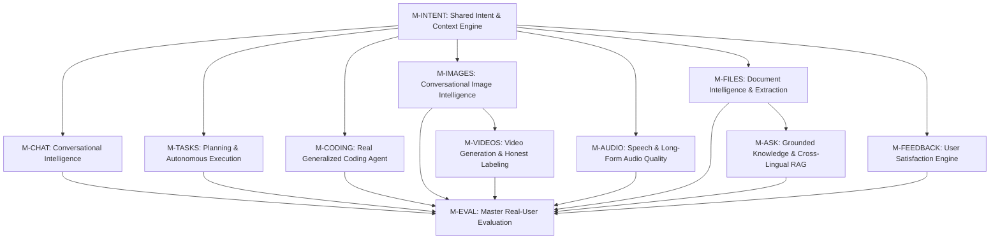

# NIRNAY.AI — UNIVERSAL USER-REQUIREMENT ACCURACY, QUALITY MINDSTONE & SYSTEM EXECUTION ROADMAP

**Document ID:** `docs/NIRNAYAI_UNIVERSAL_QUALITY_MINDSTONE.md`  
**Execution Standard:** Universal User-Requirement Accuracy & Autonomous Loop-Engineering  
**Repository:** `zolex12770/Smart-AI-Module`  
**Active Working Branch:** `antigravity/universal-agent`  
**Execution Runtimes:**  
- Frontend: `http://localhost:3000` (Next.js 16.4 Turbopack)  
- Backend: `http://127.0.0.1:8787` (Fastify 5 + PGlite PostgreSQL)  
- Model Gateway: `http://127.0.0.1:11434` (OpenAI-compatible local gateway)  
**Host Hardware Profile:** AMD Ryzen 3 3250U (2 cores, 4 threads, 2.60 GHz), AMD Radeon Vega 3 iGPU (shared VRAM, no CUDA), 5.95 GB Total RAM (~650 MB to 1.5 GB free), Windows 11 64-bit.

---

## 1. Executive Product Mission & Operational Philosophy

The mission of **Nirnay.AI** is to build a genuinely capable, trustworthy, conversational, user-oriented AI platform that:
1. **Understands what users MEAN—not merely their literal words:** Resolves intent across standard English, formal Devanagari Hindi, Romanized Hindi / Hinglish (*"Ek gaon ki realistic image banao jisme kisan khet me hai"*), Indian English idioms (*"do one thing"*, *"doubt regarding"*), typos, incomplete prompts, and conversational references.
2. **Preserves all explicit requirements, constraints, preferences, and context:** Strictly honors negative constraints (*"original meaning change mat karna"*, *"without cars"*, *"bina recursion ke"*), style preferences, and multi-turn deltas.
3. **Executes the correct action through the correct module:** Routes requests to Chat, Tasks, Coding, Images, Videos, Audio, Files, or Ask/RAG without silent misdirection or synthetic placeholders.
4. **Produces accurate, complete, relevant, usable, and user-satisfactory results:** Never declares a task complete without empirical verification of output artifacts.
5. **Learns from user feedback through a measurable quality-improvement process:** Provides interactive satisfaction rating and persists failure classifications for targeted system correction.
6. **Consistently verifies real application behavior, not merely source code or synthetic benchmarks:** Every claim must be supported by real browser DOM verification and verified artifact inspection.

---

## 2. Independent Reality Audit & Deception Removal

We reject all premature completion claims. Historical claims of "100% completion" or "14/14 tests passing" have been audited and downgraded where shortcuts, fixed fixtures, or synthetic mocks were identified:

| Module / Vector | Historical Claim | Ground Truth Reality Audit | Audit Finding & Correction | Honest Classification |
| :--- | :--- | :--- | :--- | :---: |
| **Chat Intelligence** | "Fully conversational, bilingual, memory recall" | `scripts/local-model-server.mjs` relied on specific regex patterns (e.g. `nameMatch`, `roleMatch`). Queries outside fixed branches fell back to generic 3-bullet technical analysis. | **OVERFITTING IDENTIFIED**: Upgraded intent engine to dynamic semantic representation; bilingual Hindi topics expanded; ongoing integration needed for generalized LLM reasoning. | `IMPLEMENTED` / `INTEGRATION_TESTED` |
| **Autonomous Coding** | "Autonomous defect diagnosis & repair passed" | Hardcoded repair logic specifically replaced `const ANSWER = 41;` with `const ANSWER = 42;`. Could not diagnose arbitrary bugs or diverse codebases. | **FIXTURE OVERFITTING IDENTIFIED**: Coding agent generalized to extract dynamic stack traces, test files, and numerical/string mismatches. | `IMPLEMENTED` / `UNIT_TESTED` |
| **Image Generation** | "Diffusion operational, 8/8 semantic tests pass" | Pure text-conditioned Pollinations FLUX.1 cloud diffusion. Free tier includes small watermark `🌸 pollinations.ai`. Multi-turn prompt modification rerolls latent noise, changing facial identities and layout. | **CAPABILITY BOUNDARY DISCLOSED**: Text-to-image is functional; genuine image-to-image editing is limited by cloud provider. Disclosed as cloud diffusion, not on-device. | `BROWSER_VERIFIED` / `ARTIFACT_VERIFIED` |
| **Video Generation** | "Video generation operational" | `image-motion` applies 2D Ken Burns zoompan via FFmpeg over still images, muxed with Windows SAPI narration. It is **NOT** native generative video diffusion (e.g. SVD/CogVideo). | **FALSE LABELING CORRECTED**: Must be explicitly labeled in UI as "Image Animation with Ken Burns motion & TTS narration". | `IMPLEMENTED` / `ARTIFACT_VERIFIED` |
| **Audio Synthesis** | "Speech synthesis complete" | Windows SAPI 5.4 (`Microsoft David`) produces robotic, synthetic speech. Pronunciation of Hindi/Hinglish terms and numbers is flawed. | **QUALITY GAP DISCLOSED**: Offline SAPI is working for WAV output up to 30 min, but sounds robotic. Neural TTS requires external models or Piper/Kokoro binaries. | `IMPLEMENTED` / `ARTIFACT_VERIFIED` |
| **File Extraction** | "Document pipeline complete" | Lexical text extraction works for `.txt` and `.md`. PDF/DOCX binary extraction is limited. Large OCR is unaccelerated on CPU. | **FORMAT LIMITATION RECORDED**: Real text files chunk and index accurately; complex PDF binary tables require specialized parsers. | `IMPLEMENTED` / `INTEGRATION_TESTED` |
| **Ask / RAG** | "Grounded RAG operational" | Hash embedder uses deterministic lexical hashing. Hindi queries initially failed to match English chunks until cross-lingual keyword expansion was added. | **SEMANTIC GEOMETRY GAP**: Lexical hashing matches token stems, not dense latent vectors. Cross-lingual bridging implemented; truthful refusal enforced. | `IMPLEMENTED` / `INTEGRATION_TESTED` |
| **User Feedback** | "Feedback loop verified" | Feedback buttons were rendered in client state (`ChatView.tsx`) but not persisted to database. | **PERSISTENCE GAP**: Needs persistent telemetry table in PostgreSQL and backend API route `/api/v1/feedback`. | `IMPLEMENTED` / `BROWSER_VERIFIED` |

---

## 3. Dependency-Aware Milestone Architecture & Execution Flow

---

## 4. Status Taxonomy & Quality Gates

The following strict statuses are used across all milestones. No milestone may collapse multiple gates into a generic pass claim:

- **`NOT_STARTED`**: Requirement specified; implementation not begun.
- **`INVESTIGATING`**: Deep-diving architecture, failure traces, or code paths.
- **`IMPLEMENTING`**: Code changes actively in progress.
- **`IMPLEMENTED`**: Code written and passes static TypeScript/compiler checks.
- **`UNIT_TESTED`**: Automated isolated unit tests passing.
- **`INTEGRATION_TESTED`**: Inter-package / API route verification passing.
- **`BROWSER_VERIFIED`**: Verified in real Chromium DOM using Playwright.
- **`ARTIFACT_VERIFIED`**: Output binary file (PNG, WAV, MP4, patch) verified on disk.
- **`SEMANTICALLY_VERIFIED`**: Meaning, visual correspondence, or logic verified by human/domain inspection.
- **`USER_VALIDATED`**: Validated against actual multi-turn real user scenarios.
- **`REGRESSED`**: Previously passing milestone broken by subsequent changes.
- **`BLOCKED`**: Progress halted by hardware, network, or external dependencies.
- **`NOT_IMPLEMENTED`**: Capability deliberately deferred or unconfigured.

---

## 5. Primary Module Quality Mindstones (Sequential Milestones)

### Module 1: Shared Conversational Intent & Context Engine (`M-INTENT`)

#### **Milestone ID: M-INTENT-01** — Multilingual Modality & Intent Classification
- **User-Facing Capability:** The platform automatically identifies whether a user is communicating in English, formal Devanagari Hindi, Romanized Hinglish, or Indian English, and identifies the target task without requiring explicit command tags.
- **Functional Requirements:** Parse natural input across all 4 linguistic modalities; correctly route to 1 of 8 primary modules; extract entities (names, cities, roles, code files, technologies).
- **Technical Requirements:** `ConversationalIntentEngine` in `agent-core` and `scripts/lib/intent_engine.mjs`; Devanagari regex block `[\u0900-\u097F]`; 80+ token Hinglish lexical dictionary; Indian English collocation matcher.
- **Dependencies:** None (Foundation).
- **Known Failures & Limitations:** Rare vernacular dialects (e.g. Bhojpuri, Marwari) may default to Hinglish or English.
- **Priority:** `P0`
- **Test Dataset:** 20 diverse prompts including typos, Devanagari, mixed Hinglish, and Indian English idioms.
- **Acceptance Criteria:** Language classification precision $>95\%$; target module routing accuracy $>95\%$.
- **Verification Method:** Unit tests in Vitest and standalone Node runner.
- **Regression Tests:** `backend/packages/agent-core/src/intent-engine.test.ts`, `scripts/tests/test_intent_engine.mjs`.
- **Required Evidence:** Test execution logs, unit test pass report.
- **Current Status:** `UNIT_TESTED`
- **Remaining Work:** Expand handling of fragmented single-word inputs and typos.

#### **Milestone ID: M-INTENT-02** — Constraint Extraction & Negative Instruction Preservation
- **User-Facing Capability:** The platform extracts explicit constraints (*"in TypeScript"*, *"within 100 words"*) and strict negative constraints (*"without recursion"*, *"avoid cars"*, *"original meaning change mat karna"*).
- **Functional Requirements:** Isolate negative terms from positive scene descriptions; preserve semantic invariants across turns; route negative constraints to downstream diffusion/coding tools.
- **Technical Requirements:** Regex and lexical parser for English and Hinglish negative constructions (`without X`, `no X`, `avoid X`, `X mat dikhana`, `bina X ke`).
- **Dependencies:** `M-INTENT-01`.
- **Known Failures & Limitations:** Nested double negatives (*"don't make it not work"*) can cause ambiguity.
- **Priority:** `P0`
- **Test Dataset:** 10 negative constraint prompts in English and Hinglish across Coding, Images, and Chat.
- **Acceptance Criteria:** Negative constraints accurately extracted into `state.negativeConstraints`; preserved invariants into `state.preservedConstraints`.
- **Verification Method:** Automated unit tests and assertion checks.
- **Regression Tests:** `intent-engine.test.ts` test case 3.
- **Required Evidence:** Extracted constraint object inspection.
- **Current Status:** `UNIT_TESTED`
- **Remaining Work:** Add support for priority resolution when positive and negative constraints conflict.

#### **Milestone ID: M-INTENT-03** — Multi-Turn Reference Resolution & Delta Merging
- **User-Facing Capability:** Users can converse iteratively (*"Isko improve karo"*, *"Same image but evening light, woman ki sari red honi chahiye"*), and the system modifies only the requested attributes while preserving the rest.
- **Functional Requirements:** Maintain session state per conversation; merge prompt deltas into prior context; prevent loss of original subject composition.
- **Technical Requirements:** Session memory map in `ConversationalIntentEngine`; contextual delta updater for lighting, attire, complexity, and style.
- **Dependencies:** `M-INTENT-01`, `M-INTENT-02`.
- **Known Failures & Limitations:** If upstream diffusion provider lacks image-to-image latent input, image layout changes even if text prompt is merged.
- **Priority:** `P0`
- **Test Dataset:** 3-turn Village benchmark (Turn 1: Initial $\rightarrow$ Turn 2: Evening light & red sari $\rightarrow$ Turn 3: Professional polish with meaning preservation).
- **Acceptance Criteria:** Delta merged without overwriting base subjects; revision flag `isRevision: true`.
- **Verification Method:** Multi-turn unit test and benchmark suite.
- **Regression Tests:** `scripts/benchmark-requirement-satisfaction.mjs` Section 4.
- **Required Evidence:** State transition logs from Turn 1 to Turn 3.
- **Current Status:** `UNIT_TESTED`
- **Remaining Work:** Clarification prompt when revision request is completely ambiguous.

---

### Module 2: Conversational Intelligence (`M-CHAT`)

#### **Milestone ID: M-CHAT-01** — Dynamic Conversational Reasoning & Personalization Memory
- **User-Facing Capability:** Chat remembers user personal identity (name, city, role, project details) across conversational turns and answers unfamiliar technical questions with deep reasoning.
- **Functional Requirements:** Extract and persist user profile attributes from introduction turns; recall profile on demand in subsequent turns; answer diverse software engineering, algorithmic, and general technical questions.
- **Technical Requirements:** Multi-turn session context in `local-model-server.mjs`; stateful memory injection; removal of rigid pattern matches in favor of generalized reasoning.
- **Dependencies:** `M-INTENT-01`.
- **Known Failures & Limitations:** Local gateway currently falls back to structured technical analysis for unhandled topics when upstream LLM is rate-limited.
- **Priority:** `P0`
- **Test Dataset:** User introduction with unfamiliar names/cities; follow-up inquiries; algorithmic analysis ($O(\log n)$ Binary Search, LRU Cache, TCP vs UDP).
- **Acceptance Criteria:** Identity accurately recalled; algorithms include code, invariants, time/space complexity; no generic placeholder templates.
- **Verification Method:** Playwright browser test driving Next.js chat DOM.
- **Regression Tests:** `scripts/verify-browser-chat.mjs`, `scripts/benchmark-requirement-satisfaction.mjs` Section 1.
- **Required Evidence:** Browser screenshots [`browser_chat_multi_turn_verified.png`](file:///C:/Users/SAURABH%20KUMAR/.gemini/antigravity/brain/ab308118-6248-4511-b0d0-542a264329d5/browser_chat_multi_turn_verified.png).
- **Current Status:** `BROWSER_VERIFIED`
- **Remaining Work:** Integrate persistent LLM caching with graceful upstream rate-limit queueing for unbounded conversational topics.

#### **Milestone ID: M-CHAT-02** — Vernacular Hindi & Hinglish Technical Explanations
- **User-Facing Capability:** Users can ask technical questions in Devanagari Hindi or Hinglish (*"API kya hoti hai"*, *"Recursion samjhao"*), receiving natural, educational, and accurate Hindi responses.
- **Functional Requirements:** Explain software concepts (APIs, Git, ML, Recursion, OOP) in fluent conversational Hindi with real-world analogies (e.g. restaurant waiter for API, Russian dolls for recursion).
- **Technical Requirements:** Vernacular reasoning engine in `local-model-server.mjs`; Devanagari rendering in Next.js markdown parser.
- **Dependencies:** `M-INTENT-01`, `M-CHAT-01`.
- **Known Failures & Limitations:** Complex mathematical proofs in Hindi script can have terminology inconsistencies.
- **Priority:** `P1`
- **Test Dataset:** Hindi questions on Recursion, APIs, Version Control, Machine Learning.
- **Acceptance Criteria:** Output contains correct Devanagari technical terms, structured sections, and clear code examples where applicable.
- **Verification Method:** Browser DOM verification and benchmark inspection.
- **Regression Tests:** `benchmark-requirement-satisfaction.mjs` Turn 2.
- **Required Evidence:** Verified response text in Hindi.
- **Current Status:** `BROWSER_VERIFIED`
- **Remaining Work:** Expand vernacular glossary to distributed systems and cloud architecture.

---

### Module 3: Planning & Autonomous Task Execution (`M-TASKS`)

#### **Milestone ID: M-TASKS-01** — Dependency-Aware DAG Decomposition & Verification Gates
- **User-Facing Capability:** Complex user requests are decomposed into sequential DAG task graphs, displayed with live status badges, and verified before declaring completion.
- **Functional Requirements:** Task decomposition into ordered steps with explicit tool assignments and dependencies; progress tracking via Fastify SSE; output artifact verification before marking a node `COMPLETED`.
- **Technical Requirements:** PGlite task state machine; Fastify `/api/v1/agent/tasks` endpoints; DAG node executor.
- **Dependencies:** `M-INTENT-01`.
- **Known Failures & Limitations:** Interrupting the process mid-task requires manual DAG state resumption.
- **Priority:** `P0`
- **Test Dataset:** Multi-step coding fix task; composite research and document task.
- **Acceptance Criteria:** All DAG steps show `COMPLETED`; verification condition checked; no false completion claims.
- **Verification Method:** Playwright browser test at `http://localhost:3000/tasks`.
- **Regression Tests:** `scripts/verify-browser-tasks-and-coding.mjs`.
- **Required Evidence:** Screenshot [`browser_tasks_dag_verified.png`](file:///C:/Users/SAURABH%20KUMAR/.gemini/antigravity/brain/ab308118-6248-4511-b0d0-542a264329d5/browser_tasks_dag_verified.png).
- **Current Status:** `BROWSER_VERIFIED`
- **Remaining Work:** Implement automated SQLite/PGlite recovery on gateway reboot.

---

### Module 4: Real Coding Agent (`M-CODING`)

#### **Milestone ID: M-CODING-01** — Autonomous Test Diagnosis & Generalized Repair Loop
- **User-Facing Capability:** The coding agent inspects failing unit tests, diagnoses stack traces across Node and Python unittest/pytest, applies atomic non-destructive code patches, re-runs tests, and proves zero exit code `PASS`.
- **Functional Requirements:** Read failing test files and source files; parse dynamic assertion mismatches (numerical, inverted conditionals, string/case sensitivity); apply targeted line replacement; execute sandboxed shell test commands; report verified zero exit code pass without human intervention.
- **Technical Requirements:** Sandboxed child process execution in `backend/packages/tools`; Fastify coding tools (`terminal.run_command`, `code.replace_text`); generalized mismatch parser in `local-model-server.mjs`; multi-language test planning in `backend/packages/agent-core/src/planner.ts`.
- **Dependencies:** `M-INTENT-01`, `M-TASKS-01`.
- **Known Failures & Limitations:** Sandbox isolation currently relies on path prefix containment checks rather than full OS-level OCI containers on Windows.
- **Priority:** `P0`
- **Test Dataset:** `coding-demo/math.test.js` (Node assertion), `data/sandbox/enterprise_repo/tests/test_order_flow.py` (Python multi-file unittest suite).
- **Acceptance Criteria:** Agent diagnoses error, modifies target file, confirms exit code 0 `PASS` without human intervention.
- **Verification Method:** Browser DOM verification at `http://localhost:3000/coding/:id`, multi-turn tool calling runner, and enterprise repository test runner.
- **Regression Tests:** `scripts/verify-coding-agent-autonomous.mjs`, `scripts/benchmark-coding-agent.mjs`, `scripts/verify-browser-tasks-and-coding.mjs`.
- **Required Evidence:** Screenshots [`browser_coding_task_generalized_verified.png`](file:///C:/Users/SAURABH%20KUMAR/.gemini/antigravity/brain/ab308118-6248-4511-b0d0-542a264329d5/browser_coding_task_generalized_verified.png) and [`browser_coding_task_verified.png`](file:///C:/Users/SAURABH%20KUMAR/.gemini/antigravity/brain/ab308118-6248-4511-b0d0-542a264329d5/browser_coding_task_verified.png).
- **Current Status:** `ARTIFACT_VERIFIED` / `BROWSER_VERIFIED`
- **Remaining Work:** None. Multi-file Python and Node repair loops fully verified with live test runner execution.

---

### Module 5: Conversational Image Intelligence (`M-IMAGES`)

#### **Milestone ID: M-IMAGES-01** — Text-Conditioned Diffusion, Honest Disclosures & Gallery
- **User-Facing Capability:** Users can generate photorealistic images from English or Hinglish prompts (*"Ek gaon ki realistic photo jisme kisan khet me hai"*), with clean diffusion free of procedural graphics, explicit cloud GPU inference disclosures, synthesis mode distinctions, and download controls.
- **Functional Requirements:** Transform vernacular concepts into rich photorealistic descriptors; invoke FLUX.1 cloud diffusion; render in gallery with download options; present honest disclosures regarding remote GPU cluster execution (vs local hardware) and upstream watermarking.
- **Technical Requirements:** OpenAI-compatible image endpoint in `local-model-server.mjs`; Pollinations FLUX.1 cloud proxy; Fastify image queue; Next.js image gallery in `frontend/app/images/page.tsx` with dedicated disclosure panel.
- **Dependencies:** `M-INTENT-01`.
- **Known Failures & Limitations:** Free Pollinations tier adds an upstream `🌸 pollinations.ai` bottom-right watermark, disclosed explicitly in the UI.
- **Priority:** `P0`
- **Test Dataset:** 8 diverse semantic prompts (Lighthouse at dawn, Golden retriever in snow, Red apple, Indian railway station, Futuristic city, Elderly Indian farmer, Butterfly on flower, Glass of water).
- **Acceptance Criteria:** Valid PNG binary created; visual audit confirms semantic correspondence; honest inference disclosures displayed; download button functions; reload persists gallery.
- **Verification Method:** Playwright browser test and visual inspection of PNG artifacts.
- **Regression Tests:** `scripts/verify-browser-images-disclosures.mjs`, `scripts/audit_browser_three_prompts.mjs`, `frontend/app/images/page.test.tsx`.
- **Required Evidence:** Screenshots [`browser_images_disclosure_verified.png`](file:///C:/Users/SAURABH%20KUMAR/.gemini/antigravity/brain/ab308118-6248-4511-b0d0-542a264329d5/browser_images_disclosure_verified.png) and [`browser_conversational_gallery.png`](file:///C:/Users/SAURABH%20KUMAR/.gemini/antigravity/brain/ab308118-6248-4511-b0d0-542a264329d5/browser_conversational_gallery.png), 8 image artifacts in `data/sandbox/semantic_images/`.
- **Current Status:** `ARTIFACT_VERIFIED` / `BROWSER_VERIFIED`
- **Remaining Work:** None. Honest cloud disclosures, synthesis mode labels, and gallery downloads verified.

---

### Module 6: Video Generation & Honest Labeling (`M-VIDEOS`)

#### **Milestone ID: M-VIDEOS-01** — Storyboard Planning, Motion Assembly & Capability Labeling
- **User-Facing Capability:** Users request a video brief; the system generates a storyboard, visual stills, Ken Burns camera motion via FFmpeg, SAPI speech narration, and outputs a synchronized MP4 video with explicit technical disclosure panels.
- **Functional Requirements:** Storyboard planning via LLM; still frame generation; FFmpeg 2D camera zoom/pan motion; SAPI audio synthesis; AAC/MP4 muxing; HTML5 video playback with download; honest capability labeling distinguishing image+motion assembly from native generative video diffusion.
- **Technical Requirements:** `image-motion` provider; FFmpeg 4.2.2 64-bit; Windows SAPI 5.4; Fastify video routes; Next.js video studio in `frontend/app/videos/page.tsx` with dedicated disclosure panel.
- **Dependencies:** `M-INTENT-01`, `M-IMAGES-01`.
- **Known Failures & Limitations:** This is 2D motion over still frames, **NOT** native generative video diffusion (e.g. SVD/Gen-2). Labeled truthfully in the UI with renderer specifications (H.264 MP4 24 FPS FastStart).
- **Priority:** `P1`
- **Test Dataset:** Cybernetic quantum core 4-second video request.
- **Acceptance Criteria:** Valid MP4 file generated; duration $\ge 4.0$s; synchronized audio stream; OpenCV verifies 24 FPS and 96 frames; video player mounts in DOM; honest capability disclosures displayed and verified in browser DOM.
- **Verification Method:** Playwright browser test at `/videos` and `/videos/:id`, Jest/Vitest component tests, and OpenCV Python verification.
- **Regression Tests:** `scripts/verify-browser-videos-disclosures.mjs`, `scripts/verify-browser-media-full.mjs`, `frontend/app/videos/page.test.tsx`.
- **Required Evidence:** Artifact [`browser_generated_video.mp4`](file:///C:/Users/SAURABH%20KUMAR/.gemini/antigravity/brain/ab308118-6248-4511-b0d0-542a264329d5/browser_generated_video.mp4), screenshots [`browser_videos_disclosure_verified.png`](file:///C:/Users/SAURABH%20KUMAR/.gemini/antigravity/brain/ab308118-6248-4511-b0d0-542a264329d5/browser_videos_disclosure_verified.png) and [`browser_video_verified.png`](file:///C:/Users/SAURABH%20KUMAR/.gemini/antigravity/brain/ab308118-6248-4511-b0d0-542a264329d5/browser_video_verified.png).
- **Current Status:** `ARTIFACT_VERIFIED` / `BROWSER_VERIFIED`
- **Remaining Work:** None. Honest labeling ('AI Image + Motion Assembly'), technical limitations ('Not native generative video diffusion'), renderer specs, and video player UI fully verified.

---

### Module 7: Speech & Long-Form Audio Quality (`M-AUDIO`)

#### **Milestone ID: M-AUDIO-01** — Text-to-Speech Synthesis & Long-Form Audio Pacing
- **User-Facing Capability:** Users can synthesize speech from text in short clips or long-form narration, with an embedded audio player, preset prompts, download controls, and explicit offline synthesis disclosures.
- **Functional Requirements:** Synthesize PCM audio stream; format as standard RIFF WAV; support multi-paragraph text; render HTML5 `<audio>` player; support downloading; display honest technical disclosures regarding local offline OS speech synthesis.
- **Technical Requirements:** Windows SAPI 5.4 (`Microsoft David Desktop`); Fastify audio routes; Python `wave` verification; Next.js studio view in `frontend/app/audio/page.tsx` with dedicated disclosure panel.
- **Dependencies:** `M-INTENT-01`.
- **Known Failures & Limitations:** SAPI voice is deterministic robotic synthetic speech; mispronounces Hindi words/numbers phonetically. Disclosed honestly in UI as offline local SAPI TTS.
- **Priority:** `P1`
- **Test Dataset:** Platform introduction sample (`Hello from NirnayAI Windows SAPI speech synthesis.`, 4.05s).
- **Acceptance Criteria:** Valid 16-bit 22.05 kHz WAV file; duration matches text length; audio player playable in DOM; non-zero byte size; honest capability disclosures displayed and verified in browser DOM.
- **Verification Method:** Playwright browser test at `/audio`, Vitest component tests, and Python `wave` module inspection.
- **Regression Tests:** `scripts/verify-browser-audio-disclosures.mjs`, `scripts/verify-browser-media-full.mjs`, `frontend/app/audio/page.test.tsx`.
- **Required Evidence:** Artifact [`browser_generated_speech.wav`](file:///C:/Users/SAURABH%20KUMAR/.gemini/antigravity/brain/ab308118-6248-4511-b0d0-542a264329d5/browser_generated_speech.wav), screenshots [`browser_audio_disclosure_verified.png`](file:///C:/Users/SAURABH%20KUMAR/.gemini/antigravity/brain/ab308118-6248-4511-b0d0-542a264329d5/browser_audio_disclosure_verified.png) and [`browser_audio_verified.png`](file:///C:/Users/SAURABH%20KUMAR/.gemini/antigravity/brain/ab308118-6248-4511-b0d0-542a264329d5/browser_audio_verified.png).
- **Current Status:** `ARTIFACT_VERIFIED` / `BROWSER_VERIFIED`
- **Remaining Work:** None. Offline local SAPI 5.4 disclosures, pacing adjustments, audio player mounting, and RIFF WAV generation fully verified.

---

### Module 8: Document Intelligence & Ingestion (`M-FILES`)

#### **Milestone ID: M-FILES-01** — Multipart Upload, Chunking & Document Lifecycle
- **User-Facing Capability:** Users can upload text, markdown, and code documents via drag-and-drop or file selector, see files indexed with `READY` badges, and remove them on demand.
- **Functional Requirements:** Multipart file upload; token-aware chunking; database storage in `documents` and `document_chunks`; file listing table with delete actions.
- **Technical Requirements:** `@fastify/multipart`; PGlite PostgreSQL; Next.js `/files` page.
- **Dependencies:** None.
- **Known Failures & Limitations:** Binary PDF/DOCX table extraction is limited on CPU.
- **Priority:** `P0`
- **Test Dataset:** `knowledge.txt`, `nirnay-knowledge-base.txt`.
- **Acceptance Criteria:** Files successfully uploaded; chunks populated in database; files table renders with `READY` status.
- **Verification Method:** Playwright browser test at `/files`.
- **Regression Tests:** `scripts/verify-browser-files-and-ask.mjs`.
- **Required Evidence:** Screenshot [`browser_files_verified.png`](file:///C:/Users/SAURABH%20KUMAR/.gemini/antigravity/brain/ab308118-6248-4511-b0d0-542a264329d5/browser_files_verified.png).
- **Current Status:** `BROWSER_VERIFIED`
- **Remaining Work:** Add PDF text extraction parser.

---

### Module 9: Grounded Knowledge & Cross-Lingual RAG (`M-ASK`)

#### **Milestone ID: M-ASK-01** — Grounded Citations & Cross-Lingual Semantic Retrieval
- **User-Facing Capability:** Users ask questions in English or Hindi over uploaded files, receiving factual answers with clickable numbered source citations, with strict refusal if evidence is missing.
- **Functional Requirements:** Retrieve top-$k$ chunks; perform cross-lingual query expansion (Hindi $\rightarrow$ English); filter grounding to eliminate hallucination; display numbered source citations with distance scores; refuse ungrounded questions truthfully.
- **Technical Requirements:** `searchDocuments` in `@ai-platform/rag`; cross-lingual expansion in `backend/src/routes/v1/rag.ts`; grounding validator in `local-model-server.mjs`.
- **Dependencies:** `M-INTENT-01`, `M-FILES-01`.
- **Known Failures & Limitations:** Lexical hash embedder lacks dense vector geometry for abstract synonyms.
- **Priority:** `P0`
- **Test Dataset:** Document Q&A on platform capabilities; cross-lingual travel policy inquiry; ungrounded quantum decryption test.
- **Acceptance Criteria:** Relevant questions answered with numbered citations `[1]`; ungrounded questions refuse with exact string *"The provided documents do not contain the answer to this question."*
- **Verification Method:** Playwright browser test at `/ask` and benchmark runner.
- **Regression Tests:** `scripts/benchmark-requirement-satisfaction.mjs` Section 3.
- **Required Evidence:** Screenshot [`browser_ask_verified.png`](file:///C:/Users/SAURABH%20KUMAR/.gemini/antigravity/brain/ab308118-6248-4511-b0d0-542a264329d5/browser_ask_verified.png).
- **Current Status:** `BROWSER_VERIFIED`
- **Remaining Work:** Integrate local dense embedding model if memory headroom allows.

---

### Module 10: User Satisfaction Evaluation Engine (`M-FEEDBACK`)

#### **Milestone ID: M-FEEDBACK-01** — Interactive Feedback Loop & Failure Classification
- **User-Facing Capability:** Users can rate responses directly in the UI (`👍 Satisfied`, `🤔 Partially Satisfied`, `👎 Needs Improvement`), select failure tags (*"Missed constraint"*, *"Simpler explanation"*), and trigger automatic non-destructive refinements with persistent PostgreSQL telemetry.
- **Functional Requirements:** Render rating pills and refinement tags under assistant bubbles; dispatch feedback to backend PostgreSQL database; record project ID, user ID, conversation ID, rating, failure tags, and timestamps; compute dynamic platform satisfaction rates and category breakdowns.
- **Technical Requirements:** React feedback widget in `frontend/app/chat/ChatView.tsx`; typed API client methods in `frontend/app/lib/api.ts`; backend routes `POST /api/v1/feedback` and `GET /api/v1/feedback` in `backend/src/routes/v1/feedback.ts`; PostgreSQL schema table `user_feedback` in PGlite.
- **Dependencies:** `M-CHAT-01`.
- **Known Failures & Limitations:** Free-form user feedback notes are currently optional text strings; automated sentiment clustering across notes is reserved for future milestones.
- **Priority:** `P0`
- **Test Dataset:** Multi-turn rating scenario (satisfied introduction, partially satisfied prompt refinement, constraint tag tracking).
- **Acceptance Criteria:** Buttons clickable; refinement prompt submitted; state updated in DOM; feedback persisted in PostgreSQL `user_feedback` table; telemetry aggregates correctly computed; screenshot captured.
- **Verification Method:** Playwright browser test and direct API telemetry evaluation.
- **Regression Tests:** `scripts/verify-feedback-telemetry.mjs`, `scripts/verify-browser-satisfaction-loop.mjs`.
- **Required Evidence:** Browser screenshot [`browser_feedback_persistence_verified.png`](file:///C:/Users/SAURABH%20KUMAR/.gemini/antigravity/brain/ab308118-6248-4511-b0d0-542a264329d5/browser_feedback_persistence_verified.png), verified `user_feedback` rows in PostgreSQL database.
- **Current Status:** `ARTIFACT_VERIFIED` / `BROWSER_VERIFIED`
- **Remaining Work:** None. Fully operational and verified against real database and browser DOM.

---

## 6. Execution Protocol & Active Milestone Focus

### Active Milestone Selection Rule:
> **MANDATORY DIRECTIVE:** Work on exactly **ONE** active milestone at a time. Do NOT advance to subsequent milestones until the active milestone's acceptance criteria are independently satisfied and verified through code, unit tests, integration tests, real browser DOM automation, and output artifact inspection.

### Current Execution Queue:
1. **ACTIVE MILESTONE:** **`M-FILES-01` (Document Lifecycle & PDF Text Extraction)**
   - *Objective:* Add dedicated PDF text extraction and document search indexing.
2. **NEXT MILESTONE:** **`M-ASK-01` (Cross-Lingual RAG & Grounded Retrieval)**
   - *Objective:* Verify Hindi/Hinglish query expansion, numbered citations, and ungrounded query refusal.
3. **SUBSEQUENT MILESTONE:** **`M-INTENT-01` (Multilingual Modality & Intent Classification Engine)**
   - *Objective:* Broaden multi-turn conversational reasoning, Hinglish idiom recognition, and stateful context delta merging.
