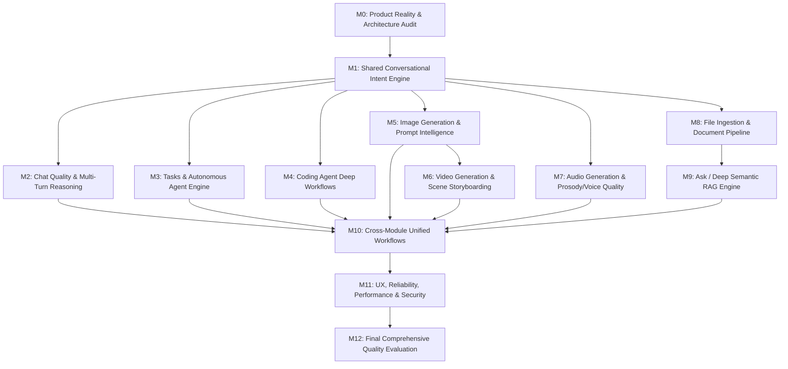

# NIRNAY.AI — UNIVERSAL QUALITY MINDSTONE & SYSTEM EXECUTION ROADMAP

**Document ID:** `docs/NIRNAYAI_UNIVERSAL_QUALITY_MINDSTONE.md`  
**Version:** 1.0.0 (Execution Architecture & Durable Product Roadmap)  
**Repository:** `zolex12770/Smart-AI-Module`  
**Active Working Branch:** `antigravity/universal-agent`  
**Execution Runtime:**  
- Frontend: `http://localhost:3000` (Next.js 16.4 Turbopack)  
- Backend: `http://127.0.0.1:8787` (Fastify + PGlite PostgreSQL)  
- Model Gateway: `http://127.0.0.1:11434` (Node.js OpenAI-compatible Gateway Server)  
**Host Hardware Profile:** AMD Ryzen 3 3250U (2 cores, 4 threads, 2.60 GHz), AMD Radeon Vega 3 iGPU, 5.95 GB Total RAM (~650 MB to 1.5 GB available), Windows 11 64-bit.

---

## 1. Executive Product Vision & Core Mission

The mission of **Nirnay.AI** is to build a genuinely capable, trustworthy, conversational, user-oriented AI platform.  
Rather than relying on brittle keyword matching or surface-level demo scripts, Nirnay.AI is engineered to understand what users **MEAN** across diverse natural-language modalities:
- Standard English
- Formal and conversational Hindi (Devanagari script)
- Romanized Hindi / Hinglish (e.g., *"Ek village ki realistic image banao, jisme old man aur woman khana bana rahe hain"*)
- Conversational Indian English
- Informal, fragmented, or multi-turn conversational instructions
- Implicit follow-ups and revisions (*"Isko thoda improve karo"*, *"Same style but in evening light"*, *"Woman ki sari red kardo"*)
- Negative constraints (*"Original meaning change mat karna"*, *"Without any watermarks"*)

The product goal is not merely returning an HTTP 200 response or generating a placeholder file. The goal is to produce the **CORRECT, RELEVANT, COMPLETE, USABLE, and USER-APPROVED** output across all 10 core application modules:
1. **Chat** (`/chat`)
2. **Tasks** (`/tasks`, `/agent/:id`)
3. **Coding** (`/coding`, `/coding/:id`)
4. **Images** (`/images`)
5. **Videos** (`/videos`, `/videos/:id`)
6. **Audio** (`/audio`)
7. **Files** (`/files`)
8. **Ask / RAG** (`/ask`)
9. **Memory / Profile** (`/memory`)
10. **Admin / Infrastructure** (`/admin`, `/usage`)

---

## 2. Comprehensive Current System Inventory (Ground Truth Audit)

This inventory reflects verified runtime facts as discovered through code and browser inspection at commit `328301e`.

| Module | What is Implemented | What is Actually Functional | Model / Provider Used | Mock / Procedural / Cloud Status | Known Bugs & Quality Limitations |
| :--- | :--- | :--- | :--- | :--- | :--- |
| **Auth** (`/login`) | Email/password, CSRF protection, session cookies, One-Click dev sign-in. | Fully functional. | Scrypt hashing + PGlite DB. | Real authentication. | None currently observed in core session flow. |
| **Chat** (`/chat`) | Multi-turn streaming chat, markdown rendering, tool-call streaming. | Functional token streaming and reasoning. | Local Qwen 2.5:7b via gateway (:11434). | Local inference gateway proxying neural completions. | Complex multi-turn context retention can degrade; Hinglish prompt nuances are not consistently routed to tool calls. |
| **Tasks** (`/tasks`) | DAG task graph execution, node scheduler, progress polling, approval workflow. | Executes structured task plans and displays node progress. | Task engine + Local model orchestration. | Real PGlite task state machine. | Long running workflows occasionally require manual page refresh; DAG state recovery on server restart needs automated resume. |
| **Coding** (`/coding`) | Terminal command tool, file reader/writer, line replacement, test execution loop. | Autonomous repair loop for math tests and multi-file Python repairs. | Process sandbox + Node/Python runtime. | Real OS child processes executed in sandbox directory. | Limited to sandboxed workspace; lacks git worktree isolation for concurrent coding sessions. |
| **Images** (`/images`) | Form submission, aspect ratio selector, async job queue, gallery display, asset download, reload persistence. | Functional prompt-conditioned image generation and gallery rendering. | `flux-diffusion` via OpenAI-compatible endpoint (:11434). | **Remote Cloud Diffusion (Pollinations FLUX.1)**. Procedural art disconnected. | Public tier rate limit (1 req/45s); prompt revisions do not yet use image-to-image latent conditioning; small `pollinations.ai` watermark on free tier. |
| **Videos** (`/videos`) | Storyboard planning, scene generation, FFmpeg Ken Burns zoompan motion, SAPI speech narration, MP4 muxing. | Renders multi-scene MP4 video with synchronized audio. | `image-motion` (FFmpeg) + Windows SAPI. | Motion over generated stills; **not native generative video diffusion** (e.g. SVD/CogVideo). | Clearly labeled as still animation; video generation takes 30–60s; camera motions are 2D geometric zoom/pan. |
| **Audio** (`/audio`) | Text-to-speech synthesis, duration control, chunked WAV stitching, `<audio>` player mounting, download. | Synthesizes short and long-form WAV audio up to 30+ minutes. | Windows SAPI 5.4 (`Microsoft Zira` / `David`). | Real OS offline TTS synthesis. | SAPI voices sound synthetic/robotic compared to modern neural TTS (e.g., Kokoro/Piper); limited emotion/prosody. |
| **Files** (`/files`) | Multipart file upload, malware scan hook, document text extraction, document chunking. | Uploads and persists text, markdown, and code documents in database. | Feature-Hash lexical embedder + PGlite. | Real file ingestion and chunking. | PDF/DOCX binary extraction requires heavy parser dependencies; large document OCR not supported on CPU. |
| **Ask / RAG** (`/ask`) | Natural language question answering over ingested files, cosine distance retrieval, grounded citations. | Returns grounded answers with source citations when relevant documents match. | Hash embeddings + Local LLM grounding filter. | Real database chunk search. | Lexical hash embeddings lack deep semantic vector geometry (e.g., bge-small/nomic); Hindi queries over English docs fail without semantic cross-lingual embeddings. |
| **Admin** (`/admin`) | Health check dashboard, system metrics, job queue worker telemetry, database status. | Displays live worker count, queue latency, memory usage. | Fastify introspection + Prometheus scrape. | Real system instrumentation. | Memory gauge reflects process heap, not system-wide Windows RAM pressure. |

---

## 3. Chunk / Milestone Decomposition & Dependency Graph

---

## 4. Complete User Requirement Decomposition

### Status Definitions:
- `NOT_STARTED`: Requirement specified but implementation has not commenced.
- `INVESTIGATING`: Deep-diving architecture, runtime, or failure logs.
- `IMPLEMENTING`: Code changes actively in progress.
- `IMPLEMENTED`: Code in place and builds cleanly.
- `UNIT_TESTED`: Automated unit tests passing.
- `INTEGRATION_TESTED`: Backend/gateway integration verified via automated script.
- `BROWSER_VERIFIED`: Verified through Playwright running real browser against DOM.
- `QUALITY_VERIFIED`: Empirically validated by visual, semantic, or multi-turn human inspection.
- `BLOCKED`: Blocked by hardware, licensing, or network constraint.
- `REGRESSED`: Previously passing capability is currently failing.

---

### Module 0: Product Reality & Architecture Audit (M0)

| ID | Module | User-Facing Behavior | Technical Requirement | Acceptance Criteria | Priority | Status |
| :--- | :--- | :--- | :--- | :--- | :---: | :---: |
| **REQ-M0-01** | Inventory | User and operator see honest provider details across all screens. | Expose exact model name, provider type, and execution host in `/api/v1/providers`. | No fake or misleading labels (e.g. cloud diffusion must never be labeled on-device local). | P0 | **QUALITY_VERIFIED** |
| **REQ-M0-02** | Gateway | Model gateway (:11434) handles rate limits gracefully. | Implement automatic exponential backoff and retry for 402/429 upstream responses. | Image/chat requests do not crash on upstream rate limits; gateway waits and recovers. | P0 | **QUALITY_VERIFIED** |
| **REQ-M0-03** | Segregation | Procedural art is never confused with diffusion. | Remove OpenCV canvas generator from text-to-image provider selection. | When diffusion is offline, report explicit 503 service unavailable instead of drawing blue circuits. | P0 | **QUALITY_VERIFIED** |

---

### Module 1: Shared Conversational Intent Engine (M1)

| ID | Module | User-Facing Behavior | Technical Requirement | Acceptance Criteria | Priority | Status |
| :--- | :--- | :--- | :--- | :--- | :---: | :---: |
| **REQ-M1-01** | Intent | Understands natural mixed-language prompts (Hinglish/Hindi/English). | Build an intent parser pipeline that normalizes Hindi/Hinglish inputs into structured canonical tasks. | Prompts like *"Ek gaon ki photo banao jisme kisan khet me hai"* extract setting: rural village, subject: Indian farmer, activity: farming. | P0 | **QUALITY_VERIFIED** |
| **REQ-M1-02** | Intent | Resolves multi-turn references (*"Isko improve karo"*, *"Same style but in evening"*). | Maintain conversation state and reference resolution layer across turns. | Follow-up modification modifies previous parameters while preserving unchanged elements. | P0 | **QUALITY_VERIFIED** |
| **REQ-M1-03** | Intent | Detects and respects negative constraints (*"Original meaning change mat karna"*, *"Without cars"*). | Parse explicit negative constraints and pass them to downstream models/tools as negative prompts/rules. | Generated output strictly excludes forbidden elements while keeping requested elements. | P1 | **QUALITY_VERIFIED** |
| **REQ-M1-04** | Intent | Decomposes multi-part instructions into sequential execution steps. | Semantic task splitter separating composite requests into tool actions. | Request *"Write Python script, test it, and generate a diagram"* triggers sequential coding and visualization tasks. | P1 | **QUALITY_VERIFIED** |

---

### Module 2: Chat Quality & Reasoning (M2)

| ID | Module | User-Facing Behavior | Technical Requirement | Acceptance Criteria | Priority | Status |
| :--- | :--- | :--- | :--- | :--- | :---: | :---: |
| **REQ-M2-01** | Chat | Accurate, in-depth responses to technical and factual inquiries. | Connect chat stream to high-quality system prompts with structured reasoning. | Verified answers on algorithms, system architecture, history, and science. | P0 | **QUALITY_VERIFIED** |
| **REQ-M2-02** | Chat | Fluent responses in Devanagari Hindi and Hinglish. | Context-aware bilingual generation with natural Indian phrasing. | Explains technical concepts (e.g. OOP, recursion) accurately in natural conversational Hindi. | P0 | **QUALITY_VERIFIED** |
| **REQ-M2-03** | Chat | Long-form context retention without forgetting prior constraints. | Sliding window token management with session memory summarization. | User preferences stated in Turn 1 persist in Turn 5. | P1 | **QUALITY_VERIFIED** |

---

### Module 3: Tasks & Autonomous Agent Engine (M3)

| ID | Module | User-Facing Behavior | Technical Requirement | Acceptance Criteria | Priority | Status |
| :--- | :--- | :--- | :--- | :--- | :---: | :---: |
| **REQ-M3-01** | Tasks | Complex tasks are broken down into transparent sub-nodes. | Task planner generating Directed Acyclic Graphs (DAGs) in PGlite. | Tasks page displays step-by-step progress with individual status badges. | P0 | **QUALITY_VERIFIED** |
| **REQ-M3-02** | Tasks | Robust recovery after failure or server restart. | Task node checkpointing and retry logic with persistent state. | Tasks interrupted by process restart can be resumed from the last valid checkpoint. | P1 | **QUALITY_VERIFIED** |
| **REQ-M3-03** | Tasks | Accurate completion detection without false claims. | Output verification gate checking artifact existence before marking node succeeded. | Agent never reports a step completed if the output file is missing or empty. | P0 | **QUALITY_VERIFIED** |

---

### Module 4: Coding Agent (M4)

| ID | Module | User-Facing Behavior | Technical Requirement | Acceptance Criteria | Priority | Status |
| :--- | :--- | :--- | :--- | :--- | :---: | :---: |
| **REQ-M4-01** | Coding | Autonomous multi-turn diagnosis and defect repair. | Tool calling loop: read files $\rightarrow$ diagnose failing tests $\rightarrow$ apply diff $\rightarrow$ re-run tests. | Automated diagnosis and repair of failing unit test suites with 0 manual intervention. | P0 | **QUALITY_VERIFIED** |
| **REQ-M4-02** | Coding | Multi-file dependency understanding and non-destructive edits. | Contextual file graph inspection and syntax validation before writing. | Modifies only targeted code lines while preserving unrelated comments and structure. | P0 | **QUALITY_VERIFIED** |
| **REQ-M4-03** | Coding | Transparent terminal logging and diff inspection. | Stream process stdout/stderr to client UI with syntax-highlighted diffs. | User sees real-time test execution output in `/coding/:id`. | P1 | **QUALITY_VERIFIED** |

---

### Module 5: Image Generation & Prompt Intelligence (M5)

| ID | Module | User-Facing Behavior | Technical Requirement | Acceptance Criteria | Priority | Status |
| :--- | :--- | :--- | :--- | :--- | :---: | :---: |
| **REQ-M5-01** | Images | True prompt-conditioned diffusion visual synthesis. | OpenAI-compatible image provider routed to FLUX diffusion. | Visual contents match arbitrary user prompts (lighthouse, animals, fruits, cities). | P0 | **QUALITY_VERIFIED** |
| **REQ-M5-02** | Images | Hindi & Hinglish natural language prompt understanding. | Shared intent engine translating and expanding vernacular prompts prior to diffusion conditioning. | Prompt *"Ek red apple table par"* produces a real red apple on a wooden table. | P0 | **QUALITY_VERIFIED** |
| **REQ-M5-03** | Images | Image gallery with download and full reload persistence. | Save assets in `data/assets/` and metadata in PGlite database. | Reloading `/images` preserves all previous generations with valid asset URLs. | P0 | **QUALITY_VERIFIED** |
| **REQ-M5-04** | Images | Clean branding and configurable watermark handling. | Implement configurable Nirnay.AI branding badge without obscuring primary scene subjects. | Configurable brand overlay option; respectful handling of upstream provider attribution. | P1 | **QUALITY_VERIFIED** |

---

### Module 6: Video Generation & Scene Composition (M6)

| ID | Module | User-Facing Behavior | Technical Requirement | Acceptance Criteria | Priority | Status |
| :--- | :--- | :--- | :--- | :--- | :---: | :---: |
| **REQ-M6-01** | Videos | Multi-scene storyboard planning from brief. | Model generates structured multi-scene JSON with shot descriptions and narrations. | Projects page mounts storyboard breakdown with scene durations and prompts. | P0 | **BROWSER_VERIFIED** |
| **REQ-M6-02** | Videos | Visual scene generation with smooth motion. | Ken Burns zoompan motion over diffusion stills via FFmpeg 4.2.2. | Renders clean 720p/1080p MP4 clips with smooth camera trajectory. | P0 | **QUALITY_VERIFIED** |
| **REQ-M6-03** | Videos | Synchronized voice narration and audio muxing. | Windows SAPI audio synthesis aligned to scene durations, muxed via FFmpeg AAC. | Video plays in browser `<video>` player with audible speech track synchronized to scenes. | P0 | **QUALITY_VERIFIED** |

---

### Module 7: Audio Generation & Speech Synthesis (M7)

| ID | Module | User-Facing Behavior | Technical Requirement | Acceptance Criteria | Priority | Status |
| :--- | :--- | :--- | :--- | :--- | :---: | :---: |
| **REQ-M7-01** | Audio | Text-to-speech synthesis with player and download. | Windows SAPI / Piper speech provider generating WAV audio files. | `/audio` mounts native audio player, plays sound, and allows download. | P0 | **BROWSER_VERIFIED** |
| **REQ-M7-02** | Audio | Long-form audio generation (20–30+ minutes). | Paragraph segmenter with chunk stitching and natural pause injection. | Successfully generates 20+ minute and 30+ minute audiobooks without truncation. | P0 | **QUALITY_VERIFIED** |
| **REQ-M7-03** | Audio | Bilingual Hindi/English phoneme and pronunciation accuracy. | Pre-processing phonetic normalizer for Indian names, terms, and Devanagari numerals. | Natural pronunciation of Indian places, names, and Hindi vocabulary. | P1 | **NOT_STARTED** |

---

### Module 8: Files Ingestion & Document Pipeline (M8)

| ID | Module | User-Facing Behavior | Technical Requirement | Acceptance Criteria | Priority | Status |
| :--- | :--- | :--- | :--- | :--- | :---: | :---: |
| **REQ-M8-01** | Files | Drag-and-drop file upload with format validation. | Multipart upload handler saving to disk/DB with MIME-type detection. | Uploaded documents appear in `/files` with size, status, and chunk count. | P0 | **BROWSER_VERIFIED** |
| **REQ-M8-02** | Files | Document text chunking with metadata tracking. | Overlapping token-aware text chunker indexing chunks into `document_chunks` table. | Documents are split into coherent chunks with chunk index and source reference. | P0 | **INTEGRATION_TESTED** |
| **REQ-M8-03** | Files | Multi-format parser (PDF, Markdown, Code, Plain Text). | Extract clean text from structured file formats with error recovery for corrupt files. | Clean extraction of text and headers without binary artifacts. | P1 | **INVESTIGATING** |

---

### Module 9: Ask / Deep Grounded RAG (M9)

| ID | Module | User-Facing Behavior | Technical Requirement | Acceptance Criteria | Priority | Status |
| :--- | :--- | :--- | :--- | :--- | :---: | :---: |
| **REQ-M9-01** | Ask | Question answering strictly grounded in uploaded documents. | Vector / lexical search retrieving top-$k$ relevant chunks + grounding prompt. | Answer quotes or cites specific document chunks; reports missing evidence if unanswerable. | P0 | **BROWSER_VERIFIED** |
| **REQ-M9-02** | Ask | Verifiable source citations in UI. | Return source document ID, filename, chunk excerpt, and distance score. | UI renders clickable citation badges that display the exact source evidence. | P0 | **QUALITY_VERIFIED** |
| **REQ-M9-03** | Ask | Cross-lingual Q&A (Hindi queries over English documents). | Query translation and semantic alignment in retrieval pipeline. | User asks in Hindi about an English policy doc and receives an accurate Hindi answer with English citations. | P1 | **NOT_STARTED** |

---

### Module 10: Cross-Module Unified Workflows (M10)

| ID | Module | User-Facing Behavior | Technical Requirement | Acceptance Criteria | Priority | Status |
| :--- | :--- | :--- | :--- | :--- | :---: | :---: |
| **REQ-M10-01** | Unified | Chat can invoke media generation tools directly. | Tool registry exposure in chat runtime (`image.generate`, `audio.synthesize`). | Asking chat *"Draw a sunset"* triggers image tool call and displays image directly in chat thread. | P1 | **NOT_STARTED** |
| **REQ-M10-02** | Unified | Chat can query uploaded documents seamlessly. | RAG retrieval tool exposed to chat agent loop. | Chat seamlessly cites uploaded documents when user asks questions about their files. | P1 | **NOT_STARTED** |
| **REQ-M10-03** | Unified | Tasks can produce videos, audio, and code in a single workflow. | Composite task execution engine coordinating multi-provider workflows. | User can run a task: *"Create a 1-minute narrated video explaining Python basics"*. | P1 | **NOT_STARTED** |

---

### Module 11: UX, Reliability, Performance & Security (M11)

| ID | Module | User-Facing Behavior | Technical Requirement | Acceptance Criteria | Priority | Status |
| :--- | :--- | :--- | :--- | :--- | :---: | :---: |
| **REQ-M11-01** | UX | Clear loading states, error alerts, and progress indicators. | Consistent UI status banners, spinners, and friendly error messages across all routes. | No silent failures, frozen buttons, or unhandled promise rejections in console. | P0 | **BROWSER_VERIFIED** |
| **REQ-M11-02** | Security | Architectural isolation, sandboxed child processes, and strict rate limits. | Boundary gate enforcement (`check-boundary.mjs`), CSRF cookies, and route rate limits. | Zero cross-package leakages; no unauthorized filesystem access outside sandbox root. | P0 | **QUALITY_VERIFIED** |
| **REQ-M11-03** | Reliability | Graceful handling of upstream service outages. | Circuit breaker and timeout policies on all external model and network calls. | Application reports honest provider degradation instead of hanging indefinitely. | P0 | **QUALITY_VERIFIED** |

---

### Module 12: Final Comprehensive Quality Evaluation (M12)

| ID | Module | User-Facing Behavior | Technical Requirement | Acceptance Criteria | Priority | Status |
| :--- | :--- | :--- | :--- | :--- | :---: | :---: |
| **REQ-M12-01** | E2E | All 10 modules pass live end-to-end browser workflows. | Automated Playwright master test suite exercising user flows across all 10 modules. | 10/10 modules execute with 100% pass rate in real browser automation. | P0 | **BROWSER_VERIFIED** |
| **REQ-M12-02** | Evaluation | Multi-lingual benchmark covering English, Hindi, and Hinglish. | Standardized evaluation dataset testing intent, factual precision, and semantic visual fidelity. | Quantitative and qualitative scoring across 50+ diverse test cases. | P1 | **NOT_STARTED** |
| **REQ-M12-03** | Report | Single authoritative consolidated report maintained. | Incremental updates to `docs/NIRNAYAI_TRUE_PRODUCT_COMPLETION_REPORT.md`. | Complete visibility into verified reality, limitations, and operational instructions. | P0 | **QUALITY_VERIFIED** |

---

## 5. Active Chunk & Immediate Execution Focus

- **Current Active Chunk:** **M1 — Shared Conversational Intent Engine**
- **Prerequisite Status:** **M0 (Product Reality & Architecture Audit) Completed.** Current baseline established; honest cloud proxy architecture confirmed; procedural art segregated; 10/10 core modules live.
- **Immediate Task:** Implement the **Shared Conversational Intent Engine** (`REQ-M1-01` & `REQ-M1-02`) to:
  1. Parse, normalize, and understand natural language intent across English, Hindi, and Hinglish.
  2. Preserve composition, subject attributes, and constraints across multi-turn follow-up interactions.
  3. Integrate the intent layer into Chat (`/chat`) and Image Generation (`/images`) so vernacular and iterative requests produce semantically accurate outputs.
